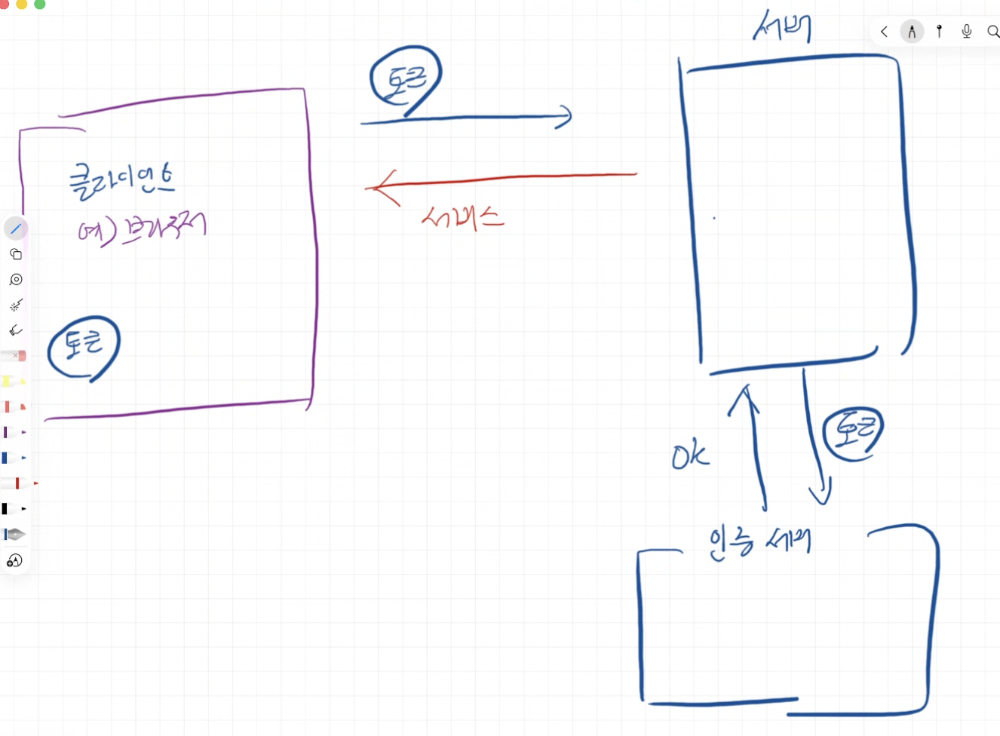
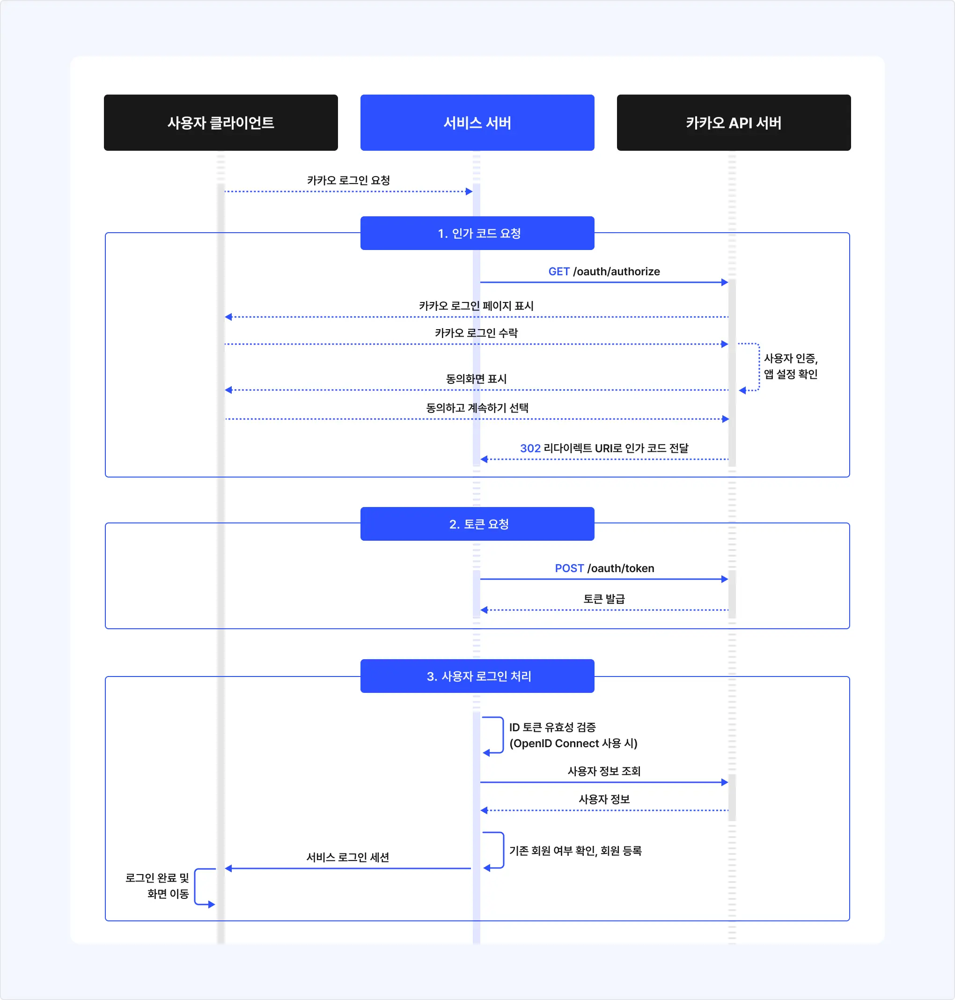
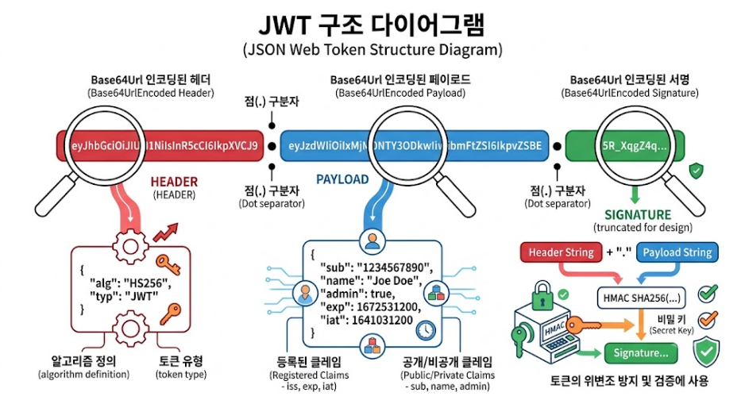
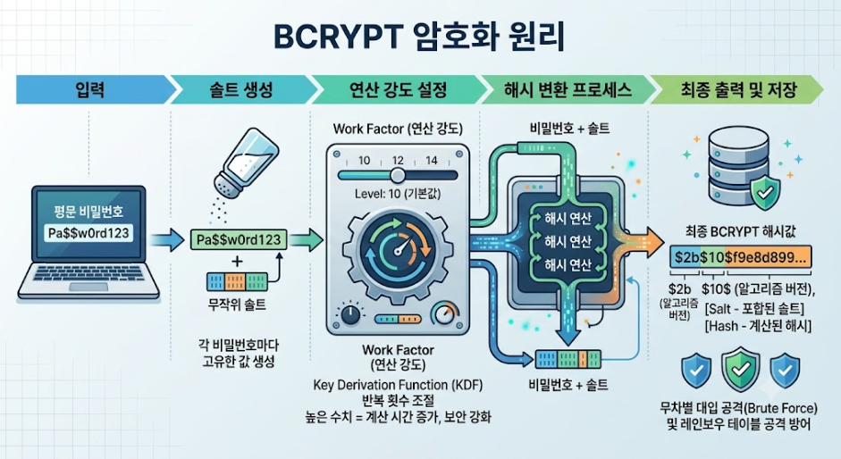
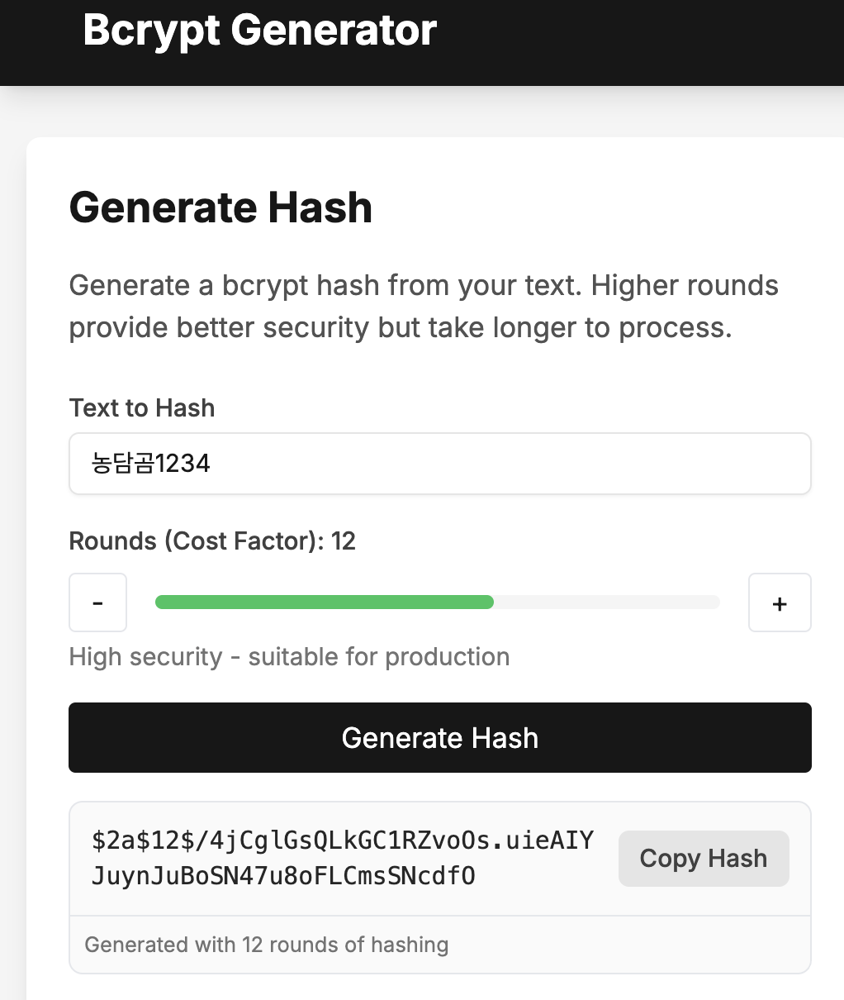
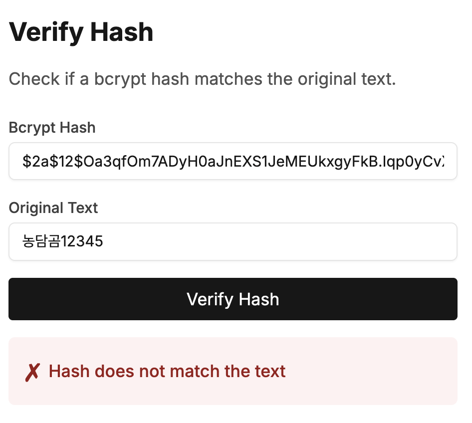

1. 클라이언트 -> 서비스 서버: 요청 + 토큰 전달
2. 서비스 서버 -> 인증 서버: '이 토큰 정상?' 확인
3. 인증 서버 -> 서비스 서버: valid or not valid
4. 서비스 서버 -> 클라이언트: if valid: return service result

```
토큰 정상 + 권한 있음 → 요청 처리 후 200 OK
토큰 없음/만료/위조 → 401 Unauthorized
토큰은 정상이나 권한 없음 → 403 Forbidden
```

\*JWT 방식:

- 서비스 서버가 매 요청마다 인증 서버에 토큰 안보냄
- 대신 서비스 서버가 직접 토큰을 검증함

```
클라이언트 ── 요청 + JWT ──▶ 서비스 서버
                              │
                              └─ 서명·만료 시간·권한을 직접 검사
```

카카오 로그인 인증 과정 예시


---

Token?

- 정보 교환 상품권.
- 출처를 확인하고, 이상이 없을 때 교환해 줌.

OAuth?

- 상품권을 발급하고 사용하는 절차와 규칙.

JWT?

- 상품권의 모양과 내용 형식
- JSON Web Token
- 토큰이 JSON 형식으로 감싸짐
- 기본 정보를 토큰에 포함. => DB에 기록할 필요가 없음
  - 회원 식별ID,
  - 만료시간,
  - 발행시간, ...
- --> 개인정보가 토큰에 JSON형식으로 담고 있어서 개인정보유출 위험이 있음.
- --> 정보 왜곡, 보안적 처리가 중요함.
- +) 일반 토큰은 개인정보나 만료시간이 DB에 기록됨.
- python에서 `PyJWT`로 사용

---

#### JWT 3가지 구성요소: `헤더` / `페이로드` / `시그니처`

- 헤더:
  - 알고리즘 유형 alg
  - 토큰 유형 typ
- 페이로드: 토큰에 포함된 데이터. JSON 문자열로 구성.
- 시그니처: 데이터 번호 검증용 시그니처 문자열
  - 서버 비밀키 + 메시지(데이터) => HASH => HMAC(메시지가 포함된 hash)

```
JWT:
Header.Payload.Signature
```

```json
header 구성
{
  "alg": "서명에 사용한 알고리즘 유형(암호화 방식)",
  "typ": "토큰 유형 - JWT"
}

payload 구성

{
  "sub": "식별자 ID(토큰주인) - 보통 회원 ID",
  "jti": "토큰식별자ID(토큰마다 부여한 고유ID)",
  "exp": "토큰유효시간",
  "iat": "토큰발급일시"
}

signature 구성
Signature =
HMAC-SHA256(
    Base64Url(Header) + "." + Base64Url(Payload),
    SECRET_KEY
)
```



---

암호화

1. 양방향 (암호화 <-> 복호화)
   - AES
   - ARIA
2. 단방향 (복호화 x) = 해시
   - 고정 해시: 항상 같은 값 => 같은 해시
     - md5
     - SHA1
     - SHA 256/512...
     - 연산 속도가 빠름 (해커가 1초에 수억 번씩 무작위로 비밀번호 대입 가능)
     - 고정 해시 무차별 대입공격 취약 => 무차별적으로 대입해서 원래 값을 알 수 있다(비번 맞을때까지 계속 입력)
     - 보안상 위험
     - 인증에는 사용 x
     - 데이터 변조 검증에는 사용 o
   - 유동 해시
     - BCRYPT: 생성할 때마다 새로운 해시값
       - 연산속도를 일부러 늦출 수 있음
       - 솔트: 비밀번호 뒤에 붙이는 무작위 문자열
       - 무차별 대입문제 완화



```
bcrypt 적용 전
원본 비밀번호: 농담곰1234

bcrypt 적용 후: $2b$12$K8xj7JmT2vF4rQ9nL1aBcO6kY3uP5dW8sH0gE2iR7tN4mC9vX1zQa

같은 비번이어도 솔트 무작위로 다시 생성 -> 매번 결과 달라짐
농담곰1234
→ $2b$12$K8xj7JmT2vF4rQ9nL1aBcO6kY3uP5dW8sH0gE2iR7tN4mC9vX1zQa

농담곰1234
→ $2b$12$M4pQ8wL2sV6kN1yJ7cDeOu9rT3xF5hG0aB2iZ6nC8mR1vS7dE4fXq

두 해시 달라도 검증 결과는 모두 True 가능
```

```python
import bcrypt

password = "농담곰1234".encode("utf-8")

hashed_password = bcrypt.hashpw(
    password,
    bcrypt.gensalt(rounds=12),
)

print(hashed_password.decode("utf-8"))

print(
    bcrypt.checkpw(
        "농담곰1234".encode("utf-8"),
        hashed_password,
    )
)  # True

print(
    bcrypt.checkpw(
        "틀린비밀번호".encode("utf-8"),
        hashed_password,
    )
)  # False
```




---

#### DIP (Dependency Inversion Principle)

core values

- High-level module: business logic
  - it shouldn't import or rely directly on concrete low-level modules
- Both should depend on shared "abstractions"
- Abstractions should not depend on details.
- details should depend on abstractions.

---

의존성 주입(Dependency Injection)

- 객체가 필요한 기능을 함수 내부에서 직접 만들지 않음
- 외부에서 생성된 객체를 전달받아 사용함
- 기능 간 결합을 느슨하게
- 요컨대 업데이트된 기술로 교체할 경우, 외부 함수로 기능을 정의하여 의존성을 주입받아 사용이 가능하다.

```python
class AuthService:
    def __init__(self):
        self.token_provider = JwtTokenProvider()
```

- 의존성 주입을 사용하지 않는 예시
- AuthService가 JwtTokenProvider()와 강하게 결합됨
- 나중에 토큰 구현을 바꾸고 싶을 때 AuthService 내부를 수정해야 함

```python
class AuthService:
    def __init__(
        self,
        token_provider: TokenProvider,
    ):
        self._token_provider = token_provider
```

- 의존성 주입을 사용하는 경우 예시
- AuthService가 구현체를 직접 생성하지 않음
- 외부에서 `TokenProvider`를 전달받음
- `TokenProvider`는 어떤 기능을 정의할지 적어놓은 규칙일 뿐 구현체가 아님
- AuthService는 구체적인 JWT 기술보다 TokenProvider 인터페이스에 의존함.

```python
# wiring/auth.py
# 여기서 구체적인 구현체를 선택하고 객체를 조립함
token_provider: TokenProvider = JwtTokenProvider()

auth_service = AuthService(
    token_provider=token_provider,
)
```

```python
# router.py
# 라우터는 AuthService를 직접 생성하지 않고,
# FastAPI의 Depends를 통해 외부에서 주입받는다.
async def login(
    request: LoginRequest,
    auth_service: Annotated[
        AuthService, # 외부에서 준비된 AuthService 객체를 파라미터로 넣어줌
        Depends(provide_auth_service),
    ],
):
    return await auth_service.login(
        request.email,
        request.password,
    )
```

---

src/auth/domain

- 인증 기능의 중심 규칙을 정의한다
- domain에서는
  - 무슨 라이브러리 사용하는지 모른다
  - DB 사용법 모른다
  - auth에 무엇이 필요한지만 선언한다

src/auth/domain/entities.py

- 인증에서 사용하는 데이터

src/auth/domain/repository.py

- 로그아웃 토큰 저장소의 규칙

src/auth/domain/service.py

- 토큰 발급, 로그인 검증 규칙

---

CORS

- 기본정책: 자원 교차 추천 허용x : SOP(Same-Origin Policy), 프로토콜, 주소, 포트가 모두 같아야 허용
- CORS: Cross-Origin Resource Sharing, 교차 출처 리소스 허용
  - "이 프론트엔드 주소는 안전하니 허용해라"라고 브라우저에 알리기
  - CORS 화이트리스트 : 허용할 프론트엔드 주소

---

Caching

- 자주 찾는 데이터를 메모리 저장소에 보관
- 같은 요청이 올 시 메모리 저장소에서 바로 꺼내줌
- Cache Hit(캐시 적중): 요청 데이터가 캐시에 있어서 빠른 응답 가능
- Cache Miss(캐시 부재): 캐시에 데이터 없거나 만료 -> 데이터베이스에서 조회 후 캐시에 저장
- TTL(Time To Live): 캐시에 바뀌지 않은 오래된 데이터 머무는 것 방지 -> Cache TTL 시간 설정(캐시 데이터가 임시 저장소에 살아 있는 시간)

EX: main.py에 미들웨어와 캐싱 통합

```python
import time
import logging
from contextlib import asynccontextmanager
from typing import List
from fastapi import FastAPI, Request, HTTPException
from fastapi.middleware.cors import CORSMiddleware
from fastapi_cache import FastAPICache
from fastapi_cache.backends.inmemory import InMemoryBackend
from fastapi_cache.decorator import cache
from domain.product import Product

# 서버 작동 상태를 보기 위한 로그 설정
logging.basicConfig(level=logging.INFO, format="%(asctime)s [%(levelname)s] - %(message)s")
logger = logging.getLogger("ecommerce_system")

# 임시 데이터베이스 역할을 할 리스트
product_database = [
    Product(id=1, name="인체공학 무선 마우스", price=85000, discount_price=79000),
    Product(id=2, name="기계식 키보드", price=140000),
    Product(id=3, name="노트북 거치대", price=45000, discount_price=39000)
]

@asynccontextmanager
async def lifespan(app: FastAPI): # lifespan: 서버 시작
    FastAPICache.init(InMemoryBackend()) # 컴퓨터 기본 메모리를 임시 저장 공간으로 사용
    logger.info("메모리 캐시 시스템이 활성화되었습니다.")
    yield
    logger.info("서버를 안전하게 종료합니다.")

app = FastAPI(title="상품 카탈로그 서비스", lifespan=lifespan)

# 허용할 프론트엔드 주소 목록 (CORS 화이트리스트)
frontend_origins = [
    "http://localhost:3000",
    "http://127.0.0.1:3000",
]

# CORS 미들웨어 설정
app.add_middleware( # app 전체에 CORS 보안 필터 적용
    CORSMiddleware,
    allow_origins=frontend_origins,
    allow_credentials=True, # cross domain 요청 시 인증 헤더를 함께 전송하도록 허용: 로그인 세션/JWT 쿠키 기반 인증에 필수
    allow_methods=["*"], # 허용할 HTTP method: all. 배포시에는 실제 사용하는 값만 명시하는 것이 안전함. (최소 권한의 원칙)
    allow_headers=["*"], # 프론트엔드에서 보낼 수 있는 요청 HTTP 헤더: 커스텀 및 표준 헤더 허용
    max_age=600, # 브라우저가 본 요청을서버에 보내기 전, 사전 요청(Preflight Request)할 때 서버에 OPTIONS method로 먼져 던져보는 확인용 요청
)

# 캐싱이 적용된 상품 목록 조회 API
@app.get("/products", response_model=List[dict])
@cache(expire=20) # 이 API 결과물을 캐시에 20초 동안 저장, 20초 안에 다시 요청하면 time.sleep(2.0) 대기 없이 결과물을 바로 응답
                    # 캐시에 결과가 남아있는 20초 동안은 원래 함수자체가 실행이 안된다.(캐시에 저장되기 때문)
                    # 첫 번째 요청 : cache miss, 두 번째 요청: cache hit
async def fetch_product_catalog():
    logger.info("캐시 부재(Cache Miss)! 데이터베이스에서 직접 가져옵니다.")

    # 데이터베이스 조회가 느린 상황을 가정하기 위해 2초간 대기합니다.
    time.sleep(2.0) # 2초간 대기 후 API 결과물은 20초동안 캐시에 저장됨.

    return [product.to_dict() for product in product_database]

# 신규 상품 등록 API
@app.post("/products", response_model=dict)
async def register_new_product(name: str, price: int, discount_price: int = None):
    generated_id = len(product_database) + 1

    try:
        new_entity = Product(id=generated_id, name=name, price=price, discount_price=discount_price)
        product_database.append(new_entity)
        logger.info(f"새 상품 등록 완료: {name}")
        return new_entity.to_dict()
    except ValueError as e:
        raise HTTPException(status_code=400, detail=str(e))
```
