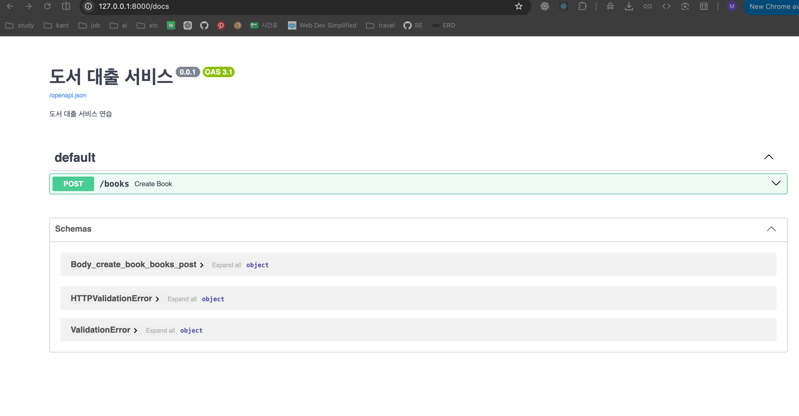

현재 구조

```python
import logging
from typing import Optional
from fastapi import FastAPI, Body, Query, HTTPException, status
from book.domain.book import Book
```

- logging : 서버 동작을 터미널에 기록
- Optional: 값이 문자열 또는 None일 수 있음
- FastAPI: API application 생성
- Body: HTTP request body에서 값을 받기
- Query: URL query param에서 값 받기
- HTTPException: HTTP 오류 응답 발생
- status: status code를 이름으로 사용

---

- `main.py`가 HTTP 요청과 응답 처리
- `book.py`가 책 객체와 도서관 규칙 처리

- FastAPI를 통해 python 프로그램이 HTTP 요청을 받을 수 있는 API 애플리케이션이 됨
  - `http://127.0.0.1:8000/docs`
  - `http://localhost:8000/docs`

```python
app = FastAPI(
    title="도서 대출 서비스",
    description="도서 대출 서비스 연습",
    version="0.0.1"
)
```

- title, description, version은 /docs의 API문서에 표시됨.

```
클라이언트
   ↓ POST /books
main.py (FastAPI / HTTP 담당)
   ↓ Book.create(...)
book.py (책 데이터와 비즈니스 규칙 담당)
   ↓ Book 객체 반환
main.py
   ↓ to_dict()
JSON 응답
```



```python
# main.py


# 클라이언트로부터의 POST /books 요청 감지
# 해당 요청이 들어올 시 create_books()함수 실행됨
@app.post("/books", status_code=status.HTTP_201_CREATED)
async def create_book(

    # ...은 필수 값
    # 클라이언트로부터 JSON 값을 받을 때,
    # FastAPI는 title과 author가 있는지 확인함(... 는 필수이므로)
    title: str = Body(..., description="등록할 책 이름"),
    author: str = Body(..., description="등록할 책 저자명")
):

    # 도서 번호는 전역변수로 관리됨.
    global id_generator
    logger.info(f"신규 도서 등록: 제목={title} 저자={author}")

    try:
        new_book = Book.create(id_generator, title, author, 'AVAILABLE')
        logger.info(f"신규 도서 등록 성공: 제목={title} 저자={author}")
        id_generator += 1
        return new_book.to_dict()

    except ValueError as err:
        logger.error(f"신규 도서 등록 실패: {str(err)}") # 에러메시지 출력, 꼼꼼히!
        raise HTTPException(status_code=status.HTTP_400_BAD_REQUEST, detail=str(err))
```

```python

# book.py
"""
[busniness requirements]
1. 도서 대여점의 도서는 2가지 상태로 관리가 된다. (대출중(RENTED), 대출 가능(AVAILABLE))
2. 대출중인 도서는 대여 불가능
3. 소규모 대여점이므로 도서별 재고는 1개 뿐 -> 도서 재고 관리는 하지 않음.
4. 도서 번호, 제목, 저자의 정보를 확인 가능 (이후 요구사항 추가)
"""
# book.py 역할: 도서 데이터를 관리하고 도서 대여점의 비즈니스 규칙을 지키는 것
from datetime import datetime

class Book:
    def __init__(self, book_id:int, title:str, author:str, status:str):
        self.id = book_id
        self.title = title
        self.author = author
        self.status = status
        self.created_at = datetime.now()

    @classmethod # 정적 접근하여 객체 생성 가능,  Book 객체를 만드는 역할.
                # 붙이면 객체가 없어도 클래스에서 바로 호출 가능
    def create(self, book_id:int, title:str, author:str, status:str):
        # status = AVALIABLE | RENTED
        if status not in ['AVAILABLE', 'RENTED']:
            raise ValueError("허용되지 않는 도서 상태입니다.")

        # 작가명, 제목이 없을 때 (공백제거시 포함) 에러 raise
        if not title or not title.strip():
            raise ValueError("도서 제목은 필수 항목입니다.")

        if not author or not author.strip():
            raise ValueError("도서 저자는 필수 항목입니다.")

        book = Book(book_id, title, author, status)
        book.created_at = datetime.now()

        return book

    def rent(self):
        if self.status != 'AVALIABLE':
            raise ValueError("대출 가능한 도서가 아닙니다.")

        self.status = "RENTED"

    def returnBook(self):
        if self.status != "RENTED":
            raise ValueError("대출 중인 도서가 아닙니다.")

        self.status = "AVAILABLE"

    # 만들어진 Book 객체를 딕셔너리로 바꾸는 역할
    # FastAPI는 변환된 딕셔너리를 JSON으로 자동 변환
    def to_dict(self) -> dict:
        """
        네트워크로 전송할 수 있도록 도메인 객체를 기본 딕셔너리로 가공합니다.
        """
        return {
            "id": self.id,
            "title": self.title,
            "author": self.author,
            "status": self.status,

            # isoformat으로 해야 JSON으로 처리 가능
            # datetime객체는 JSON으로 직접 처리하기 어려움
            "created_at": self.created_at.isoformat()
        }
```

---

멱등성: 같은 요청을 여러번 보내도 서버 최종 상태가 항상 동일함

- PATCH 보다 PUT 권장
- 재시도해도 같은 결과가 중요하다면 최종 상태를 지정하는 멱등적인 PUT 방식이 유리

---

```python
# main.py
@app.get("/books")
async def get_all_books(
    search_keyword: Optional[str] = Query(
        None,
        alias="keyword",
        description="검색 키워드",
        min_length=2
    )
):
```

```
위 코드는 다음 요청을 처리:
GET /books?keyword=파이썬
    → URL에서 검색어 받기
```
