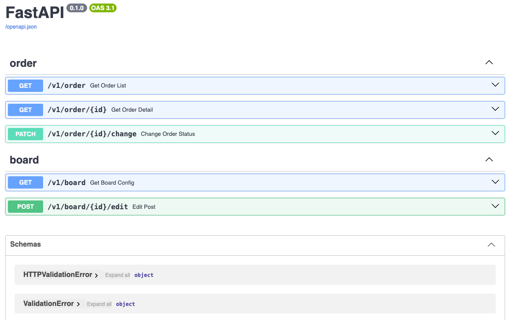
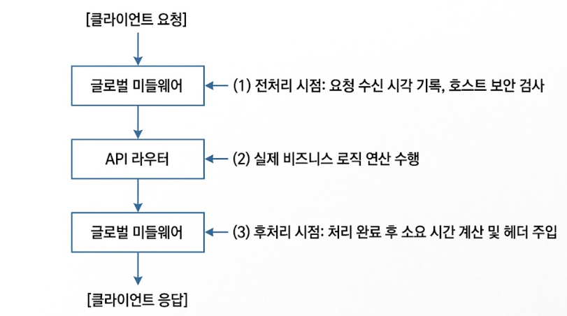

1029 3장 2강

- 매크로 파일 분리 및 임포트
- Macro: HTML 내부에서 재사용할 수 있는 함수와 같은 기능

src/templates/common_macro.html

```html

<button
  style="padding: 5px 10px; border-radius: 4px;"
  class="btn-{{ btn_type }}"
>
  {{ text }}
</button>

```

practice.html

```html
<h3>6. 외부 매크로 호출</h3>
 {{ render_button("success",
"동의하기") }} {{ render_button("danger", "취소하기") }}
```

---

템플릿 포함

- 상단 메뉴(헤더)나 하단 정보(푸터)처럼 자주 재사용되는 특정 화면 조각을 별도 파일로 분리해 두고, 필요한 페이지에 그대로 끼워 넣는 기능
- `` 태그 활용

---

정적 경로

- next.js에서 public folder 와 같은 기능 (이미지 등을 담아서 필요할 때 꺼내 씀)
- `src/static/정적자원들/files...`
- 정적자원들: css, img, JS, ...

```python

from fastapi.staticfiles import StaticFiles

# 정적 경로 설정
app.mount("/static", StaticFiles(directory=os.path.join(CURRENT_DIR, "static")), name="static")
```

- CURRENT_DIR = `chapter03-2/src`
- CURRENT_DIR + static = `chapter03-2/src/static`
  

---

uv add python-multipart

multipart: 여러 데이터를 여러 부분으로 나눠서 전송하는 방식

- 왜 필요한가? : 일은 이미지, PDF, 영상 같은 바이너리 데이터이므로 다음처럼 단순한 문자열로 합치기 어려워서 텍스트와 파일을 각각의 파트로 나눈다.
- ex) HTML에서는 다음 설정이 필요함.

```xml
<form
  method="post"
  action="/file"
  enctype="multipart/form-data"
>
```

- 각 데이터에 경계선(boundary)과 설명을 붙여 파일 경계를 분명하게 한다.

```
Boundary
name="title"

고양이 사진

Boundary
name="file"; filename="cat.png"
Content-Type: image/png

실제 이미지 데이터

Boundary 종료
```

- 이렇게 나누면 서버가 "아 이 부분은 제목/파일이구나. 파일 이름은 ~이구나. 파일 형식은 ...구나" 알 수 있음.

- 즉,

```
문자 데이터만 전송
→ application/x-www-form-urlencoded
→ key=value&key=value

파일이 포함된 데이터 전송
→ multipart/form-data
→ 텍스트와 파일을 Part별로 분리
```

```xml
<form
  method="post"
  action="/file"
  enctype="multipart/form-data"
>
  <input type="text" name="title" />
  <input type="file" name="file" />
  <button type="submit">전송</button>
</form>
```

- enctype="multipart/form-data" 설정 안하면 기본값 `application/x-www-form-urlencoded`로 적용된다. (일반 문자열에만 적합한 방식이므로 바이너리 데이터 전송에는 적합하지 않음.)

각 코드 역할

```
input type="text"  → 사용자가 문자열 입력
input type="file"  → 사용자가 파일 선택
name="title"       → 서버에 전달할 데이터 이름
name="file"        → 서버에 전달할 파일 이름
multipart/form-data → 입력 데이터들을 Part로 나누어 전송
```

브라우저는 위 폼을 다음처럼 분리한다.

```
Part 1
name="title"
값: 고양이 사진

Part 2
name="file"
filename="cat.png"
Content-Type: image/png
값: 실제 이미지 데이터
```

FastAPI에서는 HTML의 name과 Python 매개변수 이름을 맞춰서 받는다.

```python
@app.post("/file")
async def upload_file(
    title: str = Form(...),
    file: UploadFile = File(...)
):
    return {
        "title": title,
        "filename": file.filename
    }
```

---

`.mount()`

---

4장 1강
APIRouter

- 목적: 코드를 역할별로 깔끔하게 쪼개서 보관함.
- 하나의 main.py에 도메인 영역별 코드를 다 모아서 보관하면 스파게티 코드 됨
  

---

`Depends()`

- from fastapi import Depends
- API 함수가 실행되기 전에 필요한 함수를 먼저 실행하라는 FastAPI 기능

```python
router = APIRouter(
    prefix="/v1/order",
    tags=["order", "태그1"],
    dependencies=[Depends(verify_secret_token)]
)
```

---

CORS(Cross Origin Resource Sharing)

- 이 웹사이트가 API를 호출해도 되는가?
- 다른 출처의 웹사이트가 내 서버 API를 호출해도 되는지 정하는 브라우저 보안 규칙
  - 같은 출처: 동일서버, 프로토콜, 도메인 주소, 포트 번호.
- CORS 설정이 없을 경우 브라우저가 응답 사용을 막을 수 있음
- 서비스 제공하는데 그걸 다 받으면 위험하니, 허가된 서버쪽에서만 우리 서비스를 이용할 수 있도록 한정하는 기능임.
- 브라우저를 이용해서 통신하는 경우만 적용, 즉 브라우저와 서버간의 통신
- 서버와 서버끼리 통신하는 경우는 신경 안씀
- FastAPI에서는 미들웨어를 추가



- 미들웨어 함수
  - first param: request
  - second param: call_next(분기점)

```python
@app.middleware("http")
# call_next: 요청을 다음 단계(API 함수 또는 다음 미들웨어)로 넘기는 함수
async def middleware1(request: Request, call_next):
    logger.info("middleware1()의 요청 처리 전")
    response = await call_next(request)
    logger.info("middleware1()의 응답 처리 전")

    return response

@app.middleware("http")
async def middleware2(request: Request, call_next):
    logger.info("middleware2()의 요청 처리 전")
    response = await call_next(request)
    logger.info("middleware2()의 응답 처리 전")

    return response
```

- 나중에 등록한 middleware2가 middleware1를 감싼 형태

```
middleware2
└── middleware1
    └── 실제 API 함수
```

```
INFO:     127.0.0.1:52633 - "GET /v1/board HTTP/1.1" 200 OK
INFO:MIDDLEWARE:middleware2()의 요청 처리 전
INFO:MIDDLEWARE:middleware1()의 요청 처리 전
INFO:MIDDLEWARE:middleware1()의 응답 처리 전
INFO:MIDDLEWARE:middleware2()의 응답 처리 전
```

- 로그 순서: middleware2 호출 -> middleware1 호출
- 가장 나중에 정의된 미들웨어부터 호출됨.

---

X-TOKEN

- 이 요청자가 토큰을 알고 있는가?
- 서버 인증/접근 검사

---
