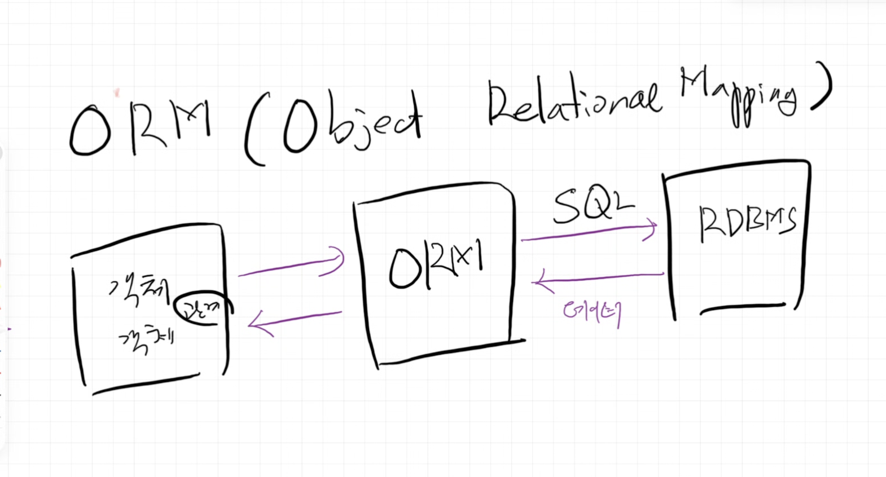

## SQLAlchemy

- 파이썬에서 DB 만질 때 쓰는 라이브러리
- ORM, connection pool 관리, DB 종류 안가림.
- db 클래스는 파이썬 클래스로 표현한다
-

#### ORM(Object Relational Mapping)

- 객체지향: 객체답게 코드를 짜라.
- 객체답게?: "자기 데이터는 자기가 책임짐"
- DB플랫폼에 (완벽하게) 종속되지 않는 장점.

객체지향코드 -> ORM -> RDBMS


#### connection pool

- 커넥션을 미리 여러개 만들어 둠: 이미 열려 있는 api 연결을 재사용해서 응답이 빨라짐
  - 커넥션 너무 많이 미리 만들어 두면 메모리 문제: 접속자수 예측해보고 거기에 맞게 만들어 둔다.
- `pool_size`로 풀 개수 제한: DB에 동시에 붙는 연결 수가 제한돼서 DB 과부하를 막음
- 커넥션이 다 쓰이면 반납될 때까지 대기함
- `with`, `Depends`+`yield`로 커넥션 사용이 끝나거나 오랜 기간동안 커넥션 사용 안하면 자동으로 반납 / 연결이 끊기게 만든다.
- 다 쓴 커넥션은 닫지 않고 풀에 반납한다.
- 연결 끊으면 객체접근시 오류나므로, 주기적으로 연결 체크해서 응답이 없으면 연결 끊어버림.

```
👔 김주원 (객체 코드)      "User 1번 데려와요."
        ↓
🤵 김비서 (Session/ORM)   "네, 사장님." → 옷장(풀)에서 커넥션 한 벌 꺼냄
        ↓
🗄️ DB                    SELECT 실행
        ↓
🤵 김비서                 다 쓰고 옷장에 다시 걸어 둠 (반납)
```
