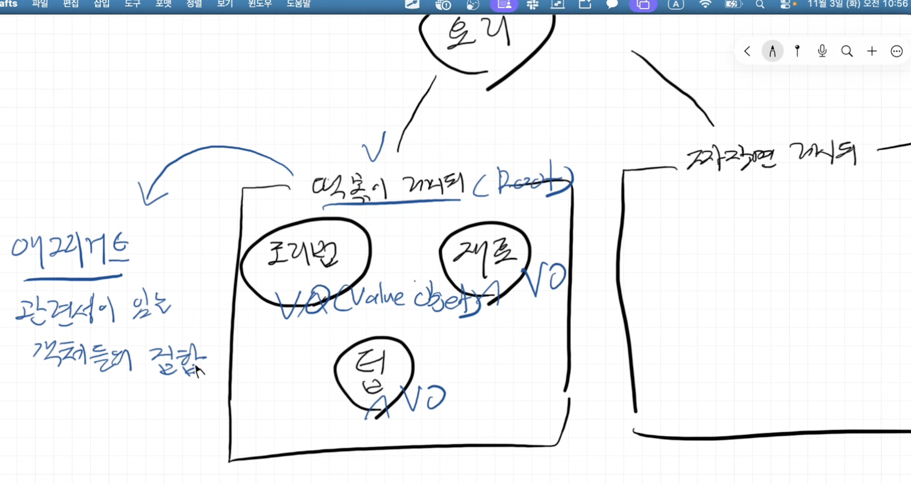
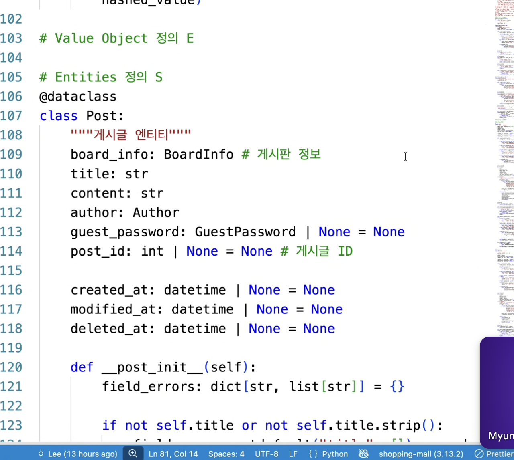
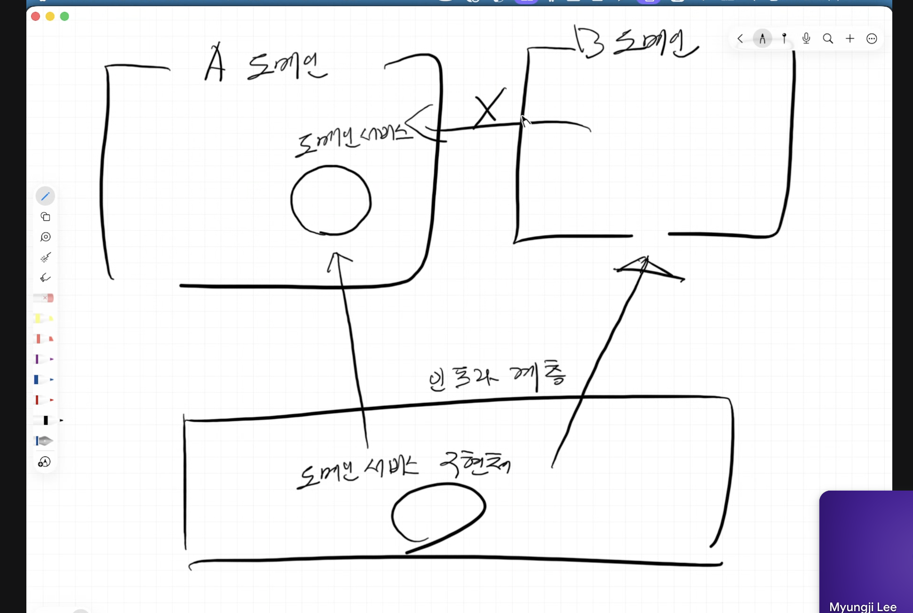
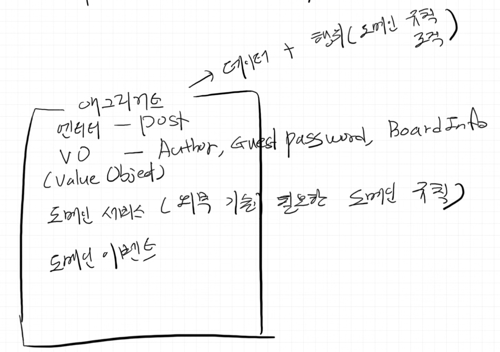

4계층(4-Layered) 아키텍처

- 좋은 아키텍처란
  - 계층간 의존성 최소화
  - 특정 기술에 종속되지 않음
  - 데이터에만 의존 x
  - 비즈니스 요구사항 명확히 반영
  - 도메인 중심 -> 도메인 계층을 먼저 정의

4계층

- 인프라 계층: infrastructure
  - models.py
  - 특정 구현 기술과 관련됨
  - 교체 가능성이 있음
  - 인프라와 다른 계층간 의존성이 발생하면 부작용.
    - 다른 계층에서 인프라를 임포트해서 쓰면 안됨.
    - 외부기술이 필요한 경우는 "추상 메서드"(구현체가 없고 메서드 정의만 존재함)를 내부 계층에 만들고 (도메인 서비스), 인프라 계층에서 이를 실제 기술로 구현함.
- 표현 계층: presentation `client`
  - schemas.py, routers.py
  - 요청 / 응답 사항 정의
- 응용 서비스 계층: application `server`
  - ex 요리하는 조리사 역할 - 조리법을 활용하고 수행함
  - 이전에 정의된 도메인 규칙들만 수행해야 한다.
- 도메인 계층: domain
  - Root: 각 도메인?
  - VO: Value Object - 값 자체에 의미가 있음 - 도메인 규칙을 함께 담음
    

```
요리 Domain
│
├── 떡볶이 레시피 Aggregate
│   ├── 떡볶이 레시피 ← Aggregate Root
│   ├── 조리 단계
│   ├── 재료
│   └── 조리 팁
│
└── 짜장면 레시피 Aggregate
    ├── 짜장면 레시피 ← Aggregate Root
    ├── 조리 단계
    ├── 재료
    └── 조리 팁
```

단방향성 유지

- 표현 -> 응용 -> 도메인
- 서로 의존성 제한

---

백엔드 프로젝트: 공연 예매 프로젝트의 4계층 아키텍처

1. 전체 요청 흐름

```
POST /v1/reservations
        ↓
Presentation
예매 요청을 받고 형식을 검사
        ↓
Application
공연과 기존 예매를 조회하고 예매 절차 진행
        ↓
Domain
예매 가능 기간, 최대 2매, 잔여 수량 등의 규칙 검사
        ↓
Infrastructure
PostgreSQL에 예매 저장
```

\*계층의 기본 의존 방향

```
Presentation → Application → Domain
                      ↑
               Infrastructure
```

2. Domain 계층

```
reservation/
└── domain/
    ├── reservation.py
    ├── ticket_quantity.py
    ├── repository.py
    └── service.py
```

- FastAPI, Pydantic, SQLAlchemy에 의존하지 않음
  Entity: Reservation

```python
from dataclasses import dataclass
from enum import Enum
from uuid import UUID


class ReservationStatus(str, Enum):
    PENDING = "PENDING"
    CONFIRMED = "CONFIRMED"
    CANCELED = "CANCELED"
    EXPIRED = "EXPIRED"


@dataclass
class Reservation:
    member_id: UUID
    performance_id: UUID
    quantity: "TicketQuantity"
    status: ReservationStatus
    id: UUID | None = None

    def confirm(self) -> None:
        if self.status != ReservationStatus.PENDING:
            raise ValueError("대기 중인 예매만 확정할 수 있습니다.")

        self.status = ReservationStatus.CONFIRMED

    def cancel(self) -> None:
        if self.status in {
            ReservationStatus.CANCELED,
            ReservationStatus.EXPIRED,
        }:
            raise ValueError("취소하거나 만료된 예매는 다시 취소할 수 없습니다.")

        self.status = ReservationStatus.CANCELED
```

VO: TicketQuantity

- vo는 고유 id x
- 값 자체로 비교함
- 유효한 값만 생성
- 생성 후 변경 x
- 값과 관련된 도메인 규칙 포함

```python
from dataclasses import dataclass

@dataclass(frozen=True)
class TicketQuantity:
    value: int

    def __post_init__(self):
        if self.value < 1:
            raise ValueError("최소 1매 이상 예매해야 합니다.")

        if self.value > 2:
            raise ValueError("공연당 최대 2매까지 예매할 수 있습니다.")
```

Aggregate, Aggregate Root

- Aggregate: 데이터 + 행위 (도메인 규칙 로직)
- Agreegat Root는 Aggregate 외부에서 접근 가능한 대표 Entity
- 상태를 바꿀 때는 Root를 통해 직접 변경함.
- 내부 값을 직접 변경하지 않음.
  - ex) avoid `reservation.status = "CANCELED"`
  - instead `reservation.cancel()`

```
Reservation Aggregate
│
├── Reservation       ← Aggregate Root
├── TicketQuantity    ← VO
└── ReservationStatus ← VO 또는 Enum
```



- 엔티티 안에 VO 가 잘 보임
  - `Post` Entity 의 속성 타입으로 `Autor` VO가 들어감.
- VO가 정의된 방식은 비즈니스 규칙
  - ex) 비밀번호는 최소 10자, 최대 20자까지 입력 가능하다.
  - VO 생성=그 값이 도메인 규칙을 통과함.

```python
@dataclass(frozen=True)
class GuestPassword:
    length: int

    def __post_init__(self):
        if self.length < 10:
            raise ValueError("최소 10자 이상 입력해야 합니다.")

        if self.length > 20:
            raise ValueError("최대 20자까지 입력할 수 있습니다.")
```

---

```python
# user/infrastructure/security.py

class BcryptPasswordHasher(PasswordHasher):

    def hash(self, raw_password: str) -> str:
        # bcrypt로 실제 해싱
        ...

    def verify(
        self,
        raw_password: str,
        hashed_password: str,
    ) -> bool:
        # bcrypt로 실제 검증
        ...
```

- 인프라에 정의된 도메인서비스 예시
  - 도메인서비스: 외부 기술이 필요한 도메인 규칙
- 특정 기술에 종속되지 않게 코드 짜기

```python
# user/domain/service.py

from abc import ABC, abstractmethod

class PasswordHasher(ABC):

    @abstractmethod
    def hash(self, raw_password: str) -> str:
        pass

    @abstractmethod
    def verify(
        self,
        raw_password: str,
        hashed_password: str,
    ) -> bool:
        pass
```

- 도메인에 정의된 도메인서비스 예시
- 도메인 객체가 외부 기술을 필요로 할 때,
- 특정 기술에 직접 의존하지 않도록 도메인에 먼저 추상화클래스로 정의함.
- 이로써 도메인이 '아는' 것: 비밀번호 hash 및 verify 가능하다.
- 그러나, hash 및 verify를 위해 '어떤 기술'이 필요한지는 인프라에 정의된 도메인서비스에서 파악 가능.

즉, 구조:

```
Domain
└── PasswordHasher           # 추상 도메인 서비스
    ├── hash()
    └── verify()
           ▲
           │ 구현
Infrastructure
└── BcryptPasswordHasher     # 실제 기술 구현체
```

- 추상 메서드: 필요한 동작의 계약을 **안쪽 계층**에 두고 구체적인 기술 구현을 **바깥쪽**에 맡기는 도구
- 도메인 A와 도메인 B는 서로 몰라야 함.
- 각 도메인에서 domain/service.py를 "추상메서드"를 통해 '어떤 기능'이 구현될건지 미리 파악하고,
- 거기에 어떤 기술이 들어가는지는 infra/...py를 통해 구체적인 기술을 구현하고 각 도메인의 도메인서비스에 연결한다.
- 

---



```
codex

“인프라가 도메인 서비스의 추상 메서드를 구현한다”
가능은 하지만, 보통은 저장소 인터페이스를 도메인 서비스보다 Repository 계약으로 둡니다. 도메인 서비스는 업무 규칙을 수행하고, 저장소는 데이터를 조회·저장하는 역할이라 서로 다릅니다.

“각 도메인이 서로를 모르는 게 최선인가?”
반드시 그렇지는 않습니다. 업무상 관계가 있으면 알아야 할 수 있어요. 다만 다른 도메인의 DB 모델이나 구현을 직접 가져다 쓰며 강하게 묶이지 않도록 합니다.

“계약을 통해 직접 구현 의존을 줄이는가?”
네. 호출하는 쪽은 계약에 의존하고, 인프라 구현체가 그 계약을 만족하게 해 결합도를 낮춥니다.

“파이썬 추상 메서드가 계약을 정의하는가?”
네. ABC와 @abstractmethod로 필요한 메서드를 선언하고, 구현하지 않은 클래스는 인스턴스화되지 않게 할 수 있습니다. 다만 파이썬의 추상 메서드는 메서드의 존재와 서명 같은 구조적 계약을 강제할 뿐, “반드시 PostgreSQL을 써야 한다”거나 “업무 규칙이 맞다”까지 보장하지는 않습니다.
```
