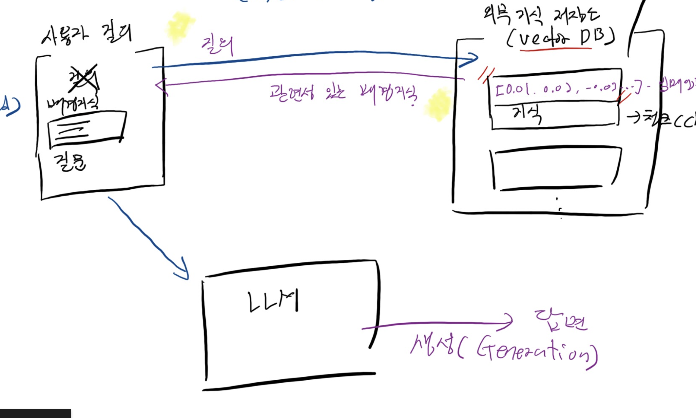
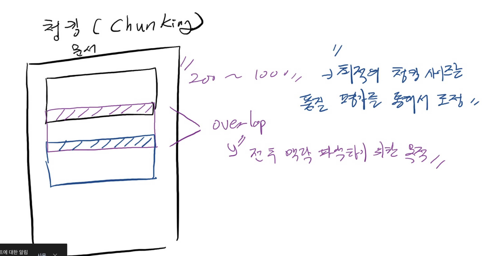
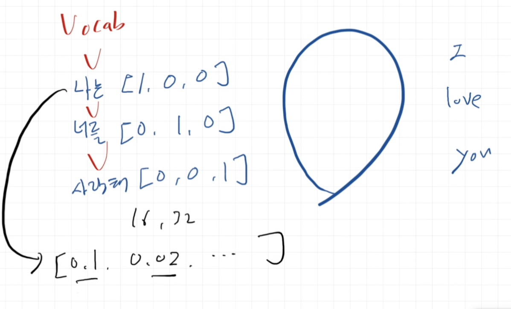

RAG - Retrieval Augmented Generation: 검색 증강 생성

- LLM의 한계
  - 지식 컷오프: 학습된 시점의 지식으로 고정됨.
  - hallucination: 지식의 부재로 인한 환각 발생
- Retrieval process: 검색을 통해 사용자가 주입한 문장과 외부의 지식이 가지고 있는 저장소를 통해 얼만큼 맥락적으로 유사한지 비교하면서 찾게 됨 by prompt 증강
  - 검색=retrieval : 임베딩 모델
- 사용자 질의에서 배경이라고 하는 프롬프트를 llm이 받고, 받은 프롬프트는 외부 지식 저장소 (vector DB)에서 답변으로 생성된다. 이것이 바로 RAG
- 특정 단락별로 쪼개는 chunking이 필요하다.
  - 이유?
  - 1.  노이즈 발생: 전체 맥락을 다 주면 질문과 관련없는 지식 생성
  - 2. Context window 문제
    - LLM이 한 번에 받을 수 있는 토큰 수 한도 존재.
    - 토큰 수가 넉넉해도 너무 크면 비용 + 응답 시간 증가
    - 뒷부분 잘릴 수 있음
  - 3. 검색 정확도
    - 논문 100장짜리를 벡터 하나로 만들면 그 안의 주제가 평균이 되버림 -> 흐릿한 벡터
    - 구체적인 질문을 던질 때 관련 부분을 정확히 찾을 수 없음 (너무 흐리멍텅해서 구체적인 답변 못찾음) -> chunk로 작게 잘라서 각각 주제에 대해 선명한 지식을 가질 수 있음.
  - **chunk**가 너무 큰 덩어리면 노이즈가 생길 수 있고, 너무 작으면 누락될 수 있다.
    - 너무 크면: 관련 없는 내용(노이즈)이 섞임 → 답변 품질과 검색 정확도 하락
    - 너무 작으면: 정보가 여러 chunk로 쪼개짐 → 일부만 검색되어 맥락 누락
    - 대책: chunk_overlap, 의미 단위 구분자(문단/조항), metadata 활용(맥락 손실)
- RAG가 뭔지만 감을 잡기 + 기법 익히기
  
  

---

1장 3강: 임베딩과 벡터 표현

임베딩?

- 문장을 학습시키려면 "마킹", 즉 "토큰화"를 해줘야 한다.
  - 토큰화: 문장을 토큰 단위로 쪼개고, 각 토큰에 번호를 붙임 (임베딩 전 필수)
- 단어 단위를 특정 차원의 실수로 표현해줌. (컴퓨터가 이해할 수 있도록)
  - -> RAG에서는 단어 하나보다 문장이나 문단(chunk) 전체를 하나의 벡터로 표현
- 과정: 문장 → 토큰화(토큰 ID 부여) → 임베딩 모델 → 벡터
- 의미가 비슷한 텍스트일수록 벡터 공간에서 가깝다
  - 코사인 유사도로 측정
- 

RAG에서 임베딩이 중요한 이유

1. 문서를 chunk로 나눔 → 각각 임베딩해서 벡터 DB에 저장
2. 사용자 질문도 같은 모델로 임베딩
3. 질문 벡터와 가장 가까운(코사인 유사도가 높은) 문서 벡터를 찾음
4. 찾은 문서를 LLM 프롬프트에 넣어 답변 생성

---

벡터 사이의 거리 (유사도) 측정법

1. 유클리디언 거리법 : 두 점 사이의 직선 거리
   $$d(A, B) = \sqrt{(a_1-b_1)^2 + (a_2-b_2)^2 + \cdots + (a_n-b_n)^2}$$

- 피타고라스 정리가 n차원이라고 생각하기
- 값이 작을수록 비슷하다
- 벡터의 크기(길이)에 영향을 받음

2. 코사인 유사도 : 두 벡터 사이의 각도 - 방향이 얼마나 같냐?
   $$\cos\theta = \frac{A \cdot B}{\|A\| \, \|B\|}$$

- 범위: -1 ~ 1
- 1일 수록 방향이 같음 = 의미가 매우 비슷하다.
- -1은 정반대 방향
- RAG에서 주로 코사인 유사도를 사용
  - 텍스트 의미 비교: 어떤 내용인지(방향)이 중요함. 문서 길이는 상관이 없음.
  - 그러나 OpenAI같은 임베딩 모델은 벡터를 길이 1로 정규화해서 내보냄 -> 무엇을 쓰든 순위가 같음 -> 실무에서는 계산이 빠른 내적(dot product)를 사용

--> 그래서, 둘의 차이가 뭐냐?

```
        ↑
        |    B (길이 짧음)
        |   ↗
        |  ↗     A (길이 김)
        | ↗   ↗
        |↗ ↗
        +-----------→

```

- 위 그래프에서 A, B는
  - 방향이 같다 --> 코사인 유사도 로 보기 : "같다" 로 판단
  - 길이가 다르다 --> 유클리디언 거리법 : "다르다"고 판단
- text 예시)
  - A: "고양이 귀여워 고양이 너무 귀여워 진짜 귀여워"
  - B: "고양이 귀여워"
    - -> 의미(방향)은 같다
    - -> 그러나 길이(강도)는 다르다

---

```
uv add ipykernel langchain langchain-core langchain-community langchain-openai python-dotenv pymupdf beautifulsoup4
```

- BeautifulSoup4?
  - HTML, XML 파싱 라이브러리
  - 웹페이지에서 원하는 텍스트만 쏙 뽑아내고 싶을 때
  - RAG에서는 광고나 다른 태그들 등 노이즈를 걷어내고 본문만 남기기 위해서 쓸 수 있다

```html
<html>
  <nav>메뉴 | 로그인 | 회원가입</nav>
  <article>
    <h1>장학금 안내</h1>
    <p>직전 학기 평점 3.5 이상이어야 합니다.</p>
  </article>
  <footer>Copyright 2026</footer>
</html>
```

```python
from bs4 import BeautifulSoup

soup = BeautifulSoup(html, "html.parser")
soup.find("h1").get_text()               # '장학금 안내'
soup.find("article").get_text(strip=True) # 본문 텍스트만
soup.find_all("p")                        # 모든 <p> 태그
```

---

임베딩도 caching이 필요하다 (2장 4강)

- 똑같은 임베딩이 있으면 -> 캐싱된 데이터를 사용함.
- 중복 비용 발생 차단
- 캐시 저장소를 연결해서 동일한 문서의 재임베딩 작업을 방지한다
