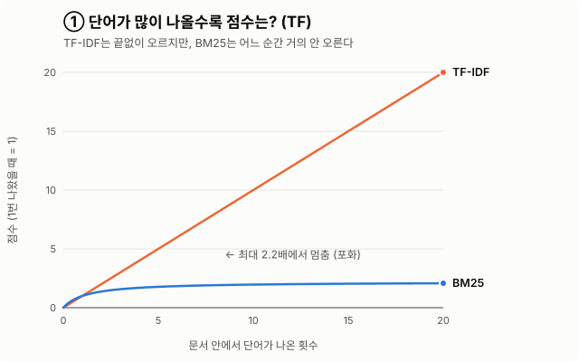
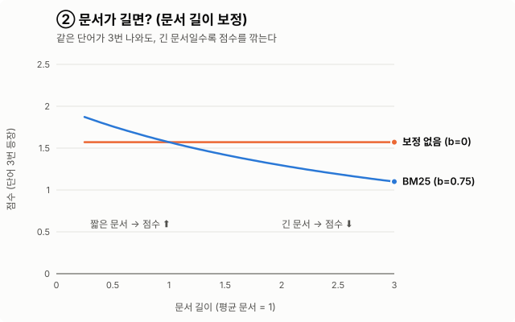
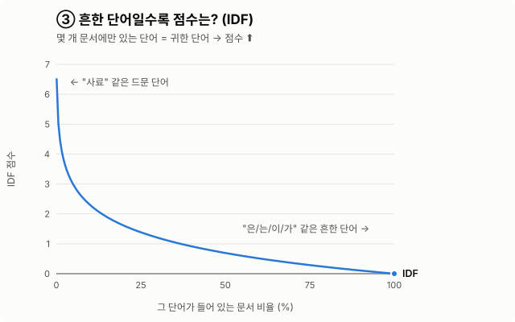
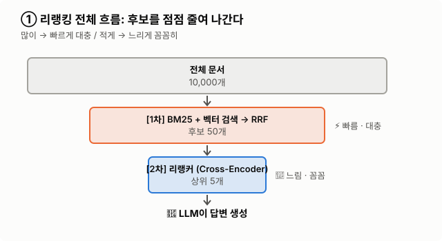
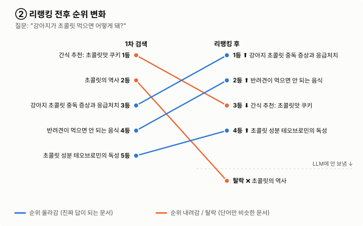
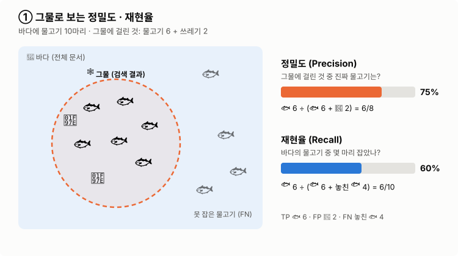
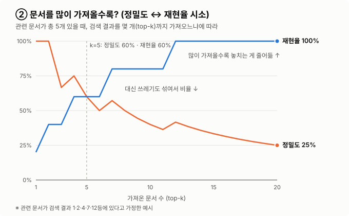
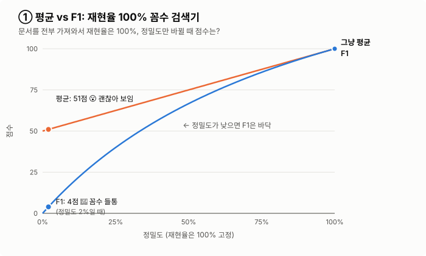
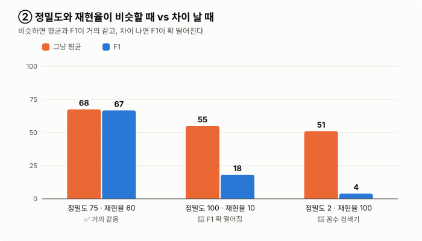

# 1116 노트

## 코사인 거리 vs 유클리드 거리

### 한 줄 요약

- **유클리드 거리**: 두 점이 "얼마나 **떨어져** 있나" (직선 거리)
- **코사인 거리**: 두 화살표가 "얼마나 **같은 방향**인가" (각도)

### 🧭 비유: 두 사람이 걷는 방향

- 철수: 북쪽으로 **1km**
- 영희: 북쪽으로 **10km**

| 방식     | 질문                     | 결과                  |
| -------- | ------------------------ | --------------------- |
| 유클리드 | 지금 얼마나 떨어져 있지? | 9km 차이 → **다르다** |
| 코사인   | 같은 쪽으로 갔나?        | 둘 다 북쪽 → **같다** |

### 📄 문장(임베딩)에 적용하면

AI는 문장을 **화살표(벡터)**로 바꾼다.

- 화살표의 **방향** = 문장의 **내용(의미)** ← 중요!
- 화살표의 **길이** = 문장 길이, 단어 반복 등 ← 덜 중요

예:

- "강아지 귀여워"
- "강아지 진짜 너무너무 귀엽고 사랑스러워"

→ 내용(방향)은 같고 길이만 다름

- 유클리드: "다른 문장" ❌
- 코사인: "같은 얘기" ✅

### ✅ RAG에서 코사인을 쓰는 이유

1. RAG는 **질문과 같은 얘기를 하는 문서**를 찾아야 함 → 방향(의미)만 보면 됨
2. 임베딩은 차원이 매우 높음(768~3072) → 유클리드 거리는 값이 다 비슷해져서 구분이 잘 안 됨
3. 대부분의 임베딩 모델이 코사인 유사도 기준으로 학습됨

### 📐 공식 (참고)

```
코사인 유사도 = (A · B) / (|A| × |B|)    → -1 ~ 1 (1이면 같은 방향)
코사인 거리   = 1 - 코사인 유사도         → 0 ~ 2 (0이면 같은 방향)
유클리드 거리 = √Σ(Aᵢ - Bᵢ)²
```

### 💡 알아두면 좋은 점

- 벡터를 길이 1로 **정규화**하면 두 방법의 **검색 순위는 똑같이** 나온다
  - `유클리드거리² = 2 × 코사인거리`
- OpenAI 임베딩처럼 이미 정규화된 벡터는 계산이 빠른 **내적(dot product)**을 쓰기도 한다

---

## BM25 키워드 검색 (TF-IDF)

### 한 줄 요약

단어가 **몇 번 나오는지(빈도수)**에 따라 **가중치(점수)**를 주는 검색 방법

### TF-IDF = TF × IDF

|                                                   | 뜻                                    | 규칙                                           | 가중치    |
| ------------------------------------------------- | ------------------------------------- | ---------------------------------------------- | --------- |
| **TF** (Term Frequency, 단어 빈도)                | 한 문서 안에서 그 단어가 몇 번 나오나 | 한 문서에 **자주** 나옴 → 중요한 단어          | ⬆️ 올라감 |
| **IDF** (Inverse Document Frequency, 역문서 빈도) | 그 단어가 전체 문서 중 몇 개에 나오나 | **모든 문서에** 자주 나옴 → 중요하지 않은 단어 | ⬇️ 내려감 |

> ⚠️ IDF의 I는 Inversion이 아니라 **Inverse**(역, 거꾸로)

### 🍕 예시: "강아지 사료 추천" 검색

- **"강아지"**: 이 문서에 10번 나옴 → TF ⬆️ → 이 문서는 강아지 얘기구나!
- **"은/는/이/가", "추천"**: 거의 모든 문서에 나옴 → IDF ⬇️ → 어디에나 있는 말이라 구분에 도움이 안 됨
- **"사료"**: 일부 문서에만 나옴 → IDF ⬆️ → 문서를 골라내는 데 유용!

👉 **이 문서에는 많이 나오는데, 다른 문서에는 잘 안 나오는 단어** = 점수가 가장 높음

### BM25란?

TF-IDF를 개선한 버전

1. **TF 상한선**: 단어가 100번 나온다고 10번보다 10배 중요하진 않음 → 점수가 일정 수준 이상 안 오름
2. **문서 길이 보정**: 긴 문서는 단어가 많이 나올 수밖에 없음 → 길이만큼 감안해서 점수 조정

### 📊 그래프로 보는 BM25



> TF-IDF: 단어가 20번 나오면 1번일 때보다 점수 20배 😵
> BM25: 아무리 많이 나와도 최대 약 2.2배에서 멈춤 (k1=1.2 기준)



> 같은 단어가 3번 나와도, 평균보다 짧은 문서는 점수 ⬆️, 긴 문서는 점수 ⬇️



> 소수의 문서에만 있는 단어일수록 점수가 높고, 거의 모든 문서에 있는 단어는 점수가 0에 가까움

### 🔍 코사인(벡터) 검색과 비교

|      | BM25 (키워드 검색)              | 코사인 (벡터 검색)                      |
| ---- | ------------------------------- | --------------------------------------- |
| 기준 | **같은 단어**가 있나            | **같은 의미**인가                       |
| 강점 | 고유명사, 제품코드, 정확한 용어 | 다른 표현, 동의어 ("강아지" ≈ "반려견") |
| 약점 | 동의어를 못 찾음                | 정확한 키워드 매칭에 약할 수 있음       |

💡 RAG에서는 둘을 같이 쓰는 **하이브리드 검색**을 많이 쓴다

---

## RRF (Reciprocal Rank Fusion, 순위 역수 융합)

### 한 줄 요약

**BM25 검색 결과**와 **벡터(코사인) 검색 결과**를 **등수로 바꿔서 합치는 방법** → 하이브리드 검색에서 사용

### 오디션 프로그램 비유

슈스케는 **문자투표**와 **심사위원 점수**를 합쳐 우승자를 뽑았다. 그런데 둘은 단위가 다르다.

|                   | 슈스케                       | RAG 검색                |
| ----------------- | ---------------------------- | ----------------------- |
| **문자투표**      | 수만 ~ 수십만 표 (끝이 없음) | **BM25** 점수 (0 ~ ∞)   |
| **심사위원 점수** | 100점 만점                   | **코사인** 점수 (0 ~ 1) |

### 😵 그냥 더하면?

```
참가자 A: 문자 300,000표 + 심사 60점 = 300,060
참가자 B: 문자 280,000표 + 심사 98점 = 280,098
```

→ 심사위원이 만점을 줘도 영향이 거의 없음 → **심사위원이 있으나 마나**

### 💡 RRF: 점수는 버리고 **등수만** 보자

```
RRF 점수 = 1 / (등수 + k)     ← 보통 k = 60
```

- 1등 → 1/(1+60) = **1/61**
- 2등 → 1/(2+60) = **1/62**
- 두 기준에서 받은 점수를 **더한다**

| 참가자 | 문자투표 (BM25) | 심사위원 (코사인) | RRF 계산                 | 최종   |
| ------ | --------------- | ----------------- | ------------------------ | ------ |
| A      | 1등             | 5등               | 1/61 + 1/65 = 0.0318     | 🥈     |
| **B**  | **2등**         | **2등**           | **1/62 + 1/62 = 0.0323** | **🥇** |
| C      | 순위 밖         | 1등               | 1/61 = 0.0164            | 🥉     |

👉 **시청자도 좋아하고 심사위원도 인정한 B가 우승!**

- A: 인기는 1등인데 심사평이 낮음
- C: 실력은 1등인데 시청자 표를 못 받음

> ※ 실제 슈스케는 비율(%)로 환산해서 합산함. 위 표는 "슈스케가 RRF를 썼다면?" 하는 가상 예시

### ❓ k = 60은 어디서 나온 숫자?

- 2009년 RRF를 처음 발표한 논문(Cormack 외, 워털루 대학)에서 **실험해 보니 60 근처가 결과가 좋았던 값**
- 수학적으로 꼭 60이어야 하는 이유는 없음 → **튜닝 값(하이퍼파라미터)**
- Elasticsearch, LangChain 등이 기본값으로 쓰면서 표준처럼 굳어짐

| k 값       | 1등 vs 2등 점수                    | 의미                             |
| ---------- | ---------------------------------- | -------------------------------- |
| k = 0      | 1/1 vs 1/2 → **2배 차이**          | 문자투표 1등만 하면 거의 우승 😵 |
| **k = 60** | 1/61 vs 1/62 → **거의 같음**       | 두 기준 모두 잘해야 우승 ✅      |
| k = 1000   | 1/1001 vs 1/1002 → **사실상 같음** | 1등이나 10등이나 별 차이 없음 🤷 |

👉 60 = **1등을 우대하되, 너무 몰아주지 않는** 적당한 값

### ✅ 정리

점수 기준이 다른 BM25와 코사인을 **등수로 바꿔서 합치면**, **두 검색 모두에서 상위권인 문서**가 최종 1등이 된다

---

## Re-ranking (리랭킹, 재순위화)

### 한 줄 요약

1차 검색으로 후보를 **대충 많이** 뽑고 → 더 똑똑한 모델이 **꼼꼼히 다시 채점해서 순위를 다시 매기는 것**

### 🎤 슈스케 비유: 예선 → 본선

지원자가 수십만 명인데 전부 심사위원이 꼼꼼히 볼 수는 없다.

| 단계     | 슈스케                                          | RAG                                                                  |
| -------- | ----------------------------------------------- | -------------------------------------------------------------------- |
| **1차**  | **예선**: 빠르게 훑어서 수십 명만 통과          | **BM25 + 벡터 검색 (+RRF)**: 수만 개 문서 중 후보 50개               |
| **2차**  | **본선**: 심사위원이 무대를 직접 보고 정밀 심사 | **리랭커**: 후보 50개를 질문과 하나씩 꼼꼼히 비교해서 다시 순위 매김 |
| **최종** | TOP 몇 명                                       | **상위 3~5개**만 LLM에게 전달                                        |

👉 **예선은 빠르게, 본선은 정확하게**

### 🤔 왜 처음부터 꼼꼼하게 안 해?

|        | 1차 검색 (Bi-Encoder, 벡터 검색)              | 2차 리랭커 (Cross-Encoder)                        |
| ------ | --------------------------------------------- | ------------------------------------------------- |
| 방식   | 질문과 문서를 **따로따로** 벡터로 바꿔서 비교 | 질문과 문서를 **한 쌍으로 묶어서 같이 읽고** 판단 |
| 속도   | ⚡ 빠름 (문서 벡터를 미리 만들어 둠)          | 🐢 느림 (문서마다 매번 새로 계산)                 |
| 정확도 | 조금 떨어짐 (예선처럼 대충)                   | 🎯 훨씬 정확함                                    |

→ 수만 개 문서 전부에 리랭커를 돌리면 너무 느리다
→ **1차로 50개만 추린 다음 그 50개에만** 리랭커를 쓴다

### 🍕 예시

질문: **"강아지가 초콜릿 먹으면 어떻게 돼?"**

| 1차 검색 순위 | 문서                                 | 리랭킹 후  |
| ------------- | ------------------------------------ | ---------- |
| 1등           | "강아지 간식 추천: 초콜릿맛 쿠키"    | 3등 ⬇️     |
| 2등           | "초콜릿의 역사"                      | 탈락 ❌    |
| 3등           | "강아지 초콜릿 중독 증상과 응급처치" | **1등 ⬆️** |

- 1차 검색: "강아지", "초콜릿" **단어나 분위기가 비슷한** 문서를 위로 올림
- 리랭커: 질문과 문서를 같이 읽어서 **실제로 답이 되는** 문서를 1등으로 올림

### 📊 그래프로 보는 리랭킹



> 1만 개 → 50개 (빠르게 대충) → 5개 (느리게 꼼꼼히) → LLM



> 🔵 파란 선(올라감): 질문에 **진짜 답이 되는** 문서
> 🟠 주황 선(내려감/탈락): "초콜릿" **단어만 비슷한** 문서

### 🧰 많이 쓰는 리랭커

- **Cohere Rerank** (API)
- **bge-reranker** (오픈소스, 한국어도 지원)
- LLM한테 직접 순위를 매기게 하는 방법도 있음

### ✅ 전체 흐름 정리

```
질문 → [1차] BM25 + 벡터 검색 → RRF로 합치기 → 후보 50개
     → [2차] 리랭커로 정밀 채점 → 상위 5개 → LLM이 답변 생성
```

---

## Query 변환 (질문 바꾸기)

### 한 줄 요약

사용자의 질문을 **그대로 검색하지 않고**, LLM으로 **검색이 잘 되는 형태로 바꾼 다음** 검색하는 것

> 왜? 사람들은 질문을 대충, 짧게, 애매하게 한다 → 그대로 검색하면 엉뚱한 문서가 나옴

### ① 질문 다시 쓰기 (Query Rewriting)

```
사용자 질문 → LLM → 검색에 유리한 질문으로 변환 → 검색
```

🍕 예시

| 사용자 질문                        | LLM이 바꾼 질문                               |
| ---------------------------------- | --------------------------------------------- |
| "우리 개가 초코 먹었는데 괜찮음??" | "강아지 초콜릿 섭취 시 중독 증상과 대처 방법" |

- 줄임말·오타·구어체 → **정확한 용어**로
- 애매한 질문 → **구체적인 질문**으로
- 질문 하나를 **여러 개로 쪼개서** 검색하기도 함 (Multi-Query)

### ② HyDE (Hypothetical Document Embeddings, 가상 문서 기법)

```
질문 → LLM → 관련 "가짜 답변 문서" 생성 → 그 가짜 문서로 검색
```

🤔 **왜 가짜 문서로 검색해?**

- **질문**과 **문서**는 생긴 게 다르다
  - 질문: "초코 먹으면 어떻게 돼?" (짧고 물음표)
  - 문서: "초콜릿에 포함된 테오브로민은 개에게 구토, 발작을..." (길고 설명형)
- 그래서 질문 벡터와 문서 벡터가 생각보다 **멀리** 떨어져 있다
- LLM이 먼저 **"답변처럼 생긴 글"**을 써 주면 → 실제 문서와 **말투·단어가 비슷해서** 벡터 검색이 잘 된다

🍕 예시

```
질문: "강아지가 초콜릿 먹으면 어떻게 돼?"
  ↓ LLM
가짜 문서: "강아지가 초콜릿을 먹으면 테오브로민 성분 때문에
           구토, 설사, 심하면 발작이 올 수 있다. 즉시 동물병원에..."
  ↓ 이 가짜 문서로 벡터 검색
진짜 문서: "강아지 초콜릿 중독 증상과 응급처치" 🎯
```

⚠️ 가짜 문서의 내용이 **틀려도 괜찮다**
→ 가짜 문서는 **검색용 미끼**일 뿐, 최종 답변은 **진짜 문서**를 보고 만든다

### 🔍 ① vs ② 비교

|                 | ① 질문 다시 쓰기                                | ② HyDE                                                           |
| --------------- | ----------------------------------------------- | ---------------------------------------------------------------- |
| LLM이 만드는 것 | **더 좋은 질문**                                | **가짜 답변 문서**                                               |
| 비유            | 도서관 사서에게 질문을 **또박또박 다시 말하기** | 찾는 책의 **한 페이지를 대충 써서** 보여주며 "이런 책 있어요?"   |
| 단점            | LLM 호출 비용                                   | LLM 호출 비용 + LLM이 아예 모르는 주제면 미끼가 엉뚱해질 수 있음 |

### ✅ 전체 흐름에서의 위치

```
질문 → [Query 변환] → [1차] BM25 + 벡터 검색 → RRF → [2차] 리랭킹 → LLM 답변
        ↑ 여기! 검색 "전"에 질문을 다듬는 단계
```

---

## RAG 평가: 검색 지표 (Precision / Recall)

> RAG 평가는 크게 **검색 지표**(문서를 잘 찾았나?)와 **생성 지표**(답변을 잘 만들었나?)로 나뉜다. 여기는 **검색 지표**.

### 먼저 TP / FP / FN 용어

| 용어   | 영어           | 뜻                                 | RAG에서                                |
| ------ | -------------- | ---------------------------------- | -------------------------------------- |
| **TP** | True Positive  | 정답이라고 했는데 **진짜 정답** ✅ | 가져온 문서 중 **진짜 관련 있는** 문서 |
| **FP** | False Positive | 정답이라고 했는데 **사실 오답** ❌ | 가져왔는데 **쓸모없는** 문서           |
| **FN** | False Negative | 오답이라고 했는데 **사실 정답** 😢 | 관련 있는데 **못 가져온** 문서         |

> ⚠️ 필기의 NF는 **FN**(False Negative)
> 💡 외우는 법: 뒷글자(P/N) = **내가 뭐라고 했나** (정답이다/아니다), 앞글자(T/F) = **그게 맞았나**

### 🎣 비유: 그물로 물고기 잡기

바다에 물고기 🐟 10마리가 있고, 그물을 던져서 8개를 건졌다.
건진 것: 🐟 6마리 + 🥾 쓰레기 2개

- TP = 6 (건진 물고기)
- FP = 2 (건진 쓰레기)
- FN = 4 (못 건진 물고기)

### ① 정밀도 (Precision)

```
Precision = TP / (TP + FP) = 건진 물고기 / 건진 것 전부
```

- **"내가 가져온 것 중에 진짜가 몇 %야?"**
- 🎣 6 / (6 + 2) = **75%**
- RAG: 검색해서 가져온 문서 5개 중 진짜 관련 문서가 몇 개냐
- 낮으면? → 쓸데없는 문서가 LLM에 들어가서 **헛소리 위험** ⬆️

### ② 재현율 (Recall)

```
Recall = TP / (TP + FN) = 건진 물고기 / 바다의 물고기 전부
```

- **"진짜 정답 중에 내가 몇 %나 찾아왔어?"**
- 🎣 6 / (6 + 4) = **60%**
- RAG: 관련 문서가 전부 몇 개인데, 그중 몇 개를 찾아왔냐
- 낮으면? → 답에 필요한 정보를 **놓쳐서** 답변이 불완전해짐

### ⚖️ 둘은 시소 관계

|           | 그물을 크게 (문서 많이 가져오기) | 그물을 작게 (문서 조금 가져오기) |
| --------- | -------------------------------- | -------------------------------- |
| Recall    | ⬆️ 물고기 많이 잡힘              | ⬇️ 놓치는 물고기 많음            |
| Precision | ⬇️ 쓰레기도 많이 딸려옴          | ⬆️ 잡은 건 대부분 물고기         |

👉 그래서 RAG는 **1차 검색은 넓게(Recall ⬆️) → 리랭킹으로 좁게(Precision ⬆️)** 하는 구조를 쓴다

### 🔍 한눈에 비교

|              | Precision (정밀도)                | Recall (재현율)              |
| ------------ | --------------------------------- | ---------------------------- |
| 질문         | 가져온 것 중 진짜는 몇 %?         | 진짜 중에 몇 % 가져왔나?     |
| 분모         | **내가 가져온 것** 전부 (TP + FP) | **실제 정답** 전부 (TP + FN) |
| 신경 쓰는 것 | 쓰레기(FP) 줄이기                 | 놓친 것(FN) 줄이기           |

### 📊 그래프로 보는 정밀도 · 재현율



> 정밀도 = 그물 **안**에서 물고기 비율 (6/8 = 75%)
> 재현율 = 바다 **전체** 물고기 중 잡은 비율 (6/10 = 60%)



> 문서를 많이 가져올수록(top-k ⬆️) → 재현율 ⬆️ / 정밀도 ⬇️
> 그래서 **1차 검색은 k를 크게 (재현율 확보) → 리랭킹으로 좁히기 (정밀도 확보)**

### ③ F1-Score (조화평균)

```
F1 = 2 × (Precision × Recall) / (Precision + Recall)
```

- 정밀도와 재현율을 **하나의 점수로 합친 것**
- 🎣 그물 예시: 2 × (0.75 × 0.6) / (0.75 + 0.6) = **0.67 (67%)**

#### 🤔 그냥 평균 내면 안 돼?

**꼼수 검색기**: 문서를 **전부** 다 가져와 버리면?

- 재현율 = **100%** (하나도 안 놓침)
- 정밀도 = **2%** (거의 다 쓰레기)

|                      | 계산                        | 결과                    |
| -------------------- | --------------------------- | ----------------------- |
| 그냥 평균 (산술평균) | (100 + 2) / 2               | **51점** 😮 괜찮아 보임 |
| F1 (조화평균)        | 2 × (1 × 0.02) / (1 + 0.02) | **약 4점** 🚨 바로 들통 |

👉 조화평균은 **둘 중 낮은 쪽에 끌려간다** → 한쪽만 잘하는 꼼수가 안 통함

#### 🎒 비유: 짝짝이 신발

- 왼쪽 신발 270mm, 오른쪽 신발 150mm → "평균 210mm니까 괜찮아" ❌
- 실제로는 **작은 쪽 때문에 못 걸음** → F1도 **약한 쪽 기준**으로 점수를 매긴다

#### ✅ 정리

| 정밀도 | 재현율 | 산술평균 | F1                             |
| ------ | ------ | -------- | ------------------------------ |
| 75%    | 60%    | 67.5%    | **66.7%** (비슷하면 거의 같음) |
| 100%   | 10%    | 55%      | **18%** (차이 나면 확 떨어짐)  |

#### 📊 그래프로 보는 F1



> 재현율 100% 꼼수 검색기: 정밀도가 바닥이어도 **그냥 평균은 최소 50점**, **F1은 0점 근처**까지 떨어짐



> 둘이 비슷하면 평균 ≈ F1 / 한쪽이 낮으면 **F1은 낮은 쪽에 끌려감**

> F1이 높다 = **정밀도와 재현율 둘 다** 괜찮다

### ❓ Q. 재현율이 낮으면 청킹 크기를 키워야 해결?

**A. 꼭 그렇진 않다!** 재현율이 **왜** 낮은지 원인부터 봐야 한다.

#### 📦 청크를 키우면 생기는 일

**✅ 좋아지는 점**

- 답이 두 청크로 **잘려 있던 경우** → 한 청크에 다 들어가서 찾기 쉬워짐
  - 예: "초콜릿은 위험하다" / "이유는 테오브로민 때문" ← 잘려 있던 게 합쳐짐

**❌ 나빠지는 점**

- 청크 하나에 여러 주제가 섞임 → 벡터의 **의미가 흐려짐**
  - 강아지 초콜릿 + 고양이 사료 + 산책 얘기가 한 청크에 있으면 → 어디에도 딱 맞지 않는 벡터 → 오히려 검색이 **안 될 수도** 있음
- 쓸모없는 내용까지 LLM에 들어감 → **정밀도 ⬇️**

🎣 그물 비유: 그물을 키우는 게 아니라 **물고기를 쓰레기랑 묶어서 덩어리로 만드는 것**

#### 🔍 원인별 해결법

| 재현율이 낮은 원인                      | 해결법                                                     |
| --------------------------------------- | ---------------------------------------------------------- |
| 답이 청크 경계에서 **잘림**             | **청크 오버랩** 늘리기, 또는 청크 크기 키우기              |
| 문서를 **너무 적게** 가져옴             | **top-k 늘리기** (5개 → 20개) + **리랭킹**으로 다시 좁히기 |
| 질문이 **애매하거나 구어체**            | **Query 변환** (질문 다시 쓰기, HyDE, Multi-Query)         |
| 고유명사·코드 같은 **키워드를 못 찾음** | **하이브리드 검색** (BM25 + 벡터 + RRF)                    |
| 임베딩 모델이 **한국어를 잘 못함**      | 더 좋은 임베딩 모델로 교체                                 |

#### 💡 꿀팁: Parent Document Retriever ("작게 검색하고, 크게 돌려주기")

```
검색할 때   → 작은 청크 (의미가 선명해서 잘 찾아짐 🎯)
LLM에 줄 때 → 그 청크가 속한 큰 덩어리(부모 문서) 통째로 (맥락 충분 📄)
```

👉 작은 청크의 **검색 정확도** + 큰 청크의 **풍부한 맥락**을 둘 다 가져감

#### ✅ 정리

청크 크기 키우기는 **답이 잘려서** 못 찾을 때만 효과가 있고, 의미가 흐려지는 부작용이 있다.
보통은 **top-k 늘리기 + 리랭킹**, **하이브리드 검색**, **Query 변환**을 먼저 시도한다.

---

## RAG 평가: 생성 지표 (충실도 / 답변 관련성)

> 검색 지표 = **문서를 잘 찾았나?** / 생성 지표 = **그 문서로 답변을 잘 만들었나?**

### 📖 비유: 오픈북 시험

LLM = **오픈북 시험을 보는 학생**

- 교과서 = 검색해 온 문서
- 시험 문제 = 사용자 질문
- 답안지 = LLM의 답변

### ① 충실도 (Faithfulness)

**"교과서에 있는 내용으로만 답했나? 지어내지 않았나?"**

```
충실도 = 문서로 뒷받침되는 문장 수 / 답변의 전체 문장 수
```

🍕 예시

- 📄 문서: "초콜릿의 테오브로민은 강아지에게 구토, 설사, 발작을 일으킬 수 있다."
- 🤖 답변:
  1. "구토와 설사가 생길 수 있어요." → ✅ 문서에 있음
  2. "발작이 올 수도 있어요." → ✅ 문서에 있음
  3. "우유를 먹이면 해독돼요." → ❌ **문서에 없음 (지어냄!)**
- 충실도 = 2/3 = **67%**

👉 충실도 ⬇️ = **환각(Hallucination)** = 그럴듯하게 **거짓말**을 함 🚨

### ② 답변 관련성 (Answer Relevancy)

**"물어본 것에 답했나? 동문서답하지 않았나?"**

🍕 예시

- ❓ 질문: "강아지가 초콜릿 먹으면 어떻게 돼?"
- 🤖 답변 A: "구토, 설사, 발작이 올 수 있으니 바로 병원에 가세요." → ✅ 관련성 높음
- 🤖 답변 B: "초콜릿은 카카오 열매로 만들며 마야 문명에서 유래했어요." → ❌ **동문서답**

**측정 방법: 질문을 거꾸로 만들어 보기**

1. LLM에게 **답변만 보여주고** "이건 어떤 질문에 대한 답일까?" → 질문을 거꾸로 생성
2. 거꾸로 만든 질문 vs **원래 질문**을 **코사인 유사도**로 비교 (👈 맨 위에 정리한 그거!)
3. 비슷하면 관련성 ⬆️

| 답변 | 거꾸로 만든 질문                           | 원래 질문과 비교 |
| ---- | ------------------------------------------ | ---------------- |
| A    | "강아지가 초콜릿 먹으면 어떤 증상이 있어?" | 비슷함 ✅        |
| B    | "초콜릿은 어디서 유래했어?"                | 다름 ❌          |

### ⚖️ 둘은 따로 봐야 한다

|                                | 관련성 ⬆️ (물어본 것에 답함)                                 | 관련성 ⬇️ (동문서답)                    |
| ------------------------------ | ------------------------------------------------------------ | --------------------------------------- |
| **충실도 ⬆️** (문서 내용만 씀) | 🏆 **최고의 답변**                                           | 사실이긴 한데 엉뚱한 얘기 (초콜릿 역사) |
| **충실도 ⬇️** (지어냄)         | 🚨 **가장 위험!** 질문에 딱 맞게 거짓말 ("우유 먹이면 해독") | 최악                                    |

👉 **둘 다 높아야** 좋은 답변
👉 특히 **관련성 ⬆️ + 충실도 ⬇️**가 가장 위험 → 그럴듯해서 사람이 믿어 버림 **Hallucination**

### 🧰 참고

- **RAGAS**: RAG 평가 라이브러리, 이 지표들을 많이 씀
- 채점도 **LLM이 대신** 함 (**LLM-as-a-Judge**)

### ✅ 한 줄 요약

- **충실도**: 문서에 있는 내용만 말했나? → 거짓말 체크 🤥
- **답변 관련성**: 질문에 맞는 답을 했나? → 동문서답 체크 🤷

---

## RAG 평가셋 (Golden Set, 골든셋)

### 한 줄 요약

RAG를 채점하려고 미리 만들어 두는 **"시험지 + 정답지"**

### 📖 오픈북 시험 비유 (이어서)

| 항목 | 오픈북 시험 | 누가 만드나 |
| --- | --- | --- |
| **질문** (Question) | 시험 문제 | 👩‍🏫 사람이 미리 |
| **모범정답** (Ground Truth) | 선생님 정답지 | 👩‍🏫 사람이 미리 |
| **근거문서** (Ground Truth Context) | "교과서 32쪽에 답 있음" 표시 | 👩‍🏫 사람이 미리 |
| **답변** (Answer) | 학생이 쓴 답안지 | 🤖 **RAG가 채점 때** 만듦 |

> ⚠️ 엄밀히는 **골든셋 = 질문 + 모범정답 + 근거문서** (3개)
> **답변**은 평가를 돌릴 때 RAG가 채워 넣는 칸

### 🍕 예시 한 줄

| 질문 | 모범정답 | 근거문서 | 답변 (RAG) |
| --- | --- | --- | --- |
| 강아지가 초콜릿 먹으면? | 테오브로민 때문에 구토·설사·발작이 올 수 있어 즉시 병원에 가야 함 | 「강아지 초콜릿 중독 증상과 응급처치」 | 구토와 설사가 생길 수 있어요. 우유를 먹이면 해독돼요. |

→ 이런 줄을 **50~100개** 정도 만들어 두고 한꺼번에 채점

### 🎯 어떤 칸끼리 비교해서 어떤 점수가 나오나

| 지표 | 무엇 ↔ 무엇 | 위 예시 결과 |
| --- | --- | --- |
| **정밀도 / 재현율** (검색) | 검색해 온 문서 ↔ **근거문서** | 근거문서를 찾아왔나? |
| **충실도** (생성) | 답변 ↔ 검색해 온 문서 | "우유로 해독" 지어냄 → ⬇️ |
| **답변 관련성** (생성) | 답변 ↔ **질문** | 질문에 맞게 답함 → ⬆️ |
| **정답 일치도** (Answer Correctness) | 답변 ↔ **모범정답** | "병원 가라"를 빠뜨림 → ⬇️ |

👉 칸이 하나라도 없으면 **어떤 지표는 계산 불가**
- 근거문서 없음 → 검색 지표(정밀도/재현율) ❌
- 모범정답 없음 → 정답 일치도 ❌

### 🛠️ 어떻게 만들어?

1. **사람이 직접**: 가장 정확하지만 오래 걸림 (실제 사용자 질문 로그를 쓰면 좋음)
2. **LLM으로 자동 생성 + 사람이 검수**: 문서를 주고 "이 문서로 질문·정답 만들어 줘" (RAGAS의 Testset Generator)

💡 **"골든"인 이유**: 이게 **기준(정답)**이 되니까! 골든셋이 틀리면 채점도 다 틀어짐 → 꼭 사람이 확인

### ✅ 정리

골든셋 = **질문 + 모범정답 + 근거문서**로 만든 정답지
→ 여기에 RAG의 **답변**을 채워 넣고 비교하면 → **검색 지표 + 생성 지표**를 한 번에 채점

### 🔁 개선 · 회귀 검증 = 골든셋으로 반복 채점

**같은 골든셋으로 채점을 반복**하면서, RAG를 고칠 때마다
- 점수가 **좋아졌는지** (개선)
- 오히려 **망가진 데는 없는지** (회귀)

를 확인하는 것

#### 반복 흐름

```
① 지금 RAG를 골든셋으로 채점 → 기준 점수 (Baseline)
② 하나만 바꾸기 (예: 리랭커 추가)
③ 같은 골든셋으로 다시 채점
④ 점수 비교 → 좋아졌으면 채택 ✅ / 나빠졌으면 되돌리기 ↩️
⑤ 다시 ②로
```

> ⚠️ 핵심: **골든셋을 바꾸지 않는다!**
> 시험지가 매번 바뀌면 점수가 오른 게 실력 때문인지 시험이 쉬워져서인지 알 수 없음
> 💡 한 번에 **하나만** 바꿔야 무엇 때문에 좋아졌는지/나빠졌는지 알 수 있음

#### 🤔 "회귀"가 뭔데?

**회귀(Regression) = 뒤로 돌아감**
→ **예전엔 잘 되던 게, 뭔가를 고친 뒤로 안 되는 것**

🍕 예시: 청크 크기를 키웠더니

| 지표 | 바꾸기 전 | 바꾼 후 | |
| --- | --- | --- | --- |
| 재현율 | 60% | **80%** | ⬆️ 개선 🎉 |
| 정밀도 | 75% | **50%** | ⬇️ **회귀!** 🚨 |
| 충실도 | 90% | 88% | 비슷 |

→ 재현율만 봤으면 "좋아졌다!" 하고 넘어갔을 것
→ **지표를 전부 같이 봐야** 한다

질문 단위로도 확인
- "강아지 초콜릿" 질문: 예전엔 맞힘 → 이제 틀림 🚨 **회귀**

#### 🎤 비유: 슈스케 참가자 연습

- 고음을 연습했더니 고음은 좋아짐 (**개선**)
- 그런데 발음이 뭉개짐 (**회귀**)
- 그래서 매번 **같은 노래(골든셋)**로 녹음해서 **전체를** 다시 들어 봄

#### ✅ 정리

개선·회귀 검증 = **같은 골든셋으로 반복 채점**하면서, 바꾼 게 **정말 좋아졌는지 + 다른 데를 망가뜨리진 않았는지** 확인하는 것
