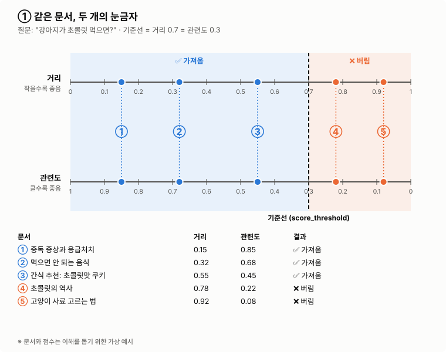
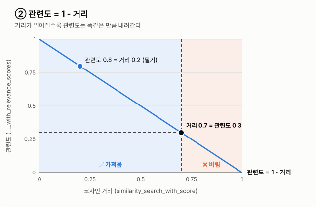
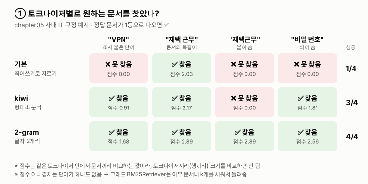
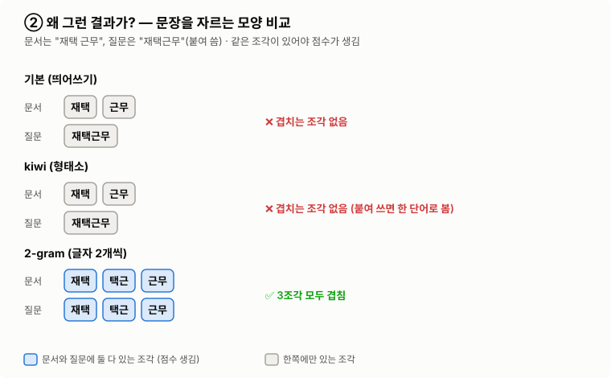
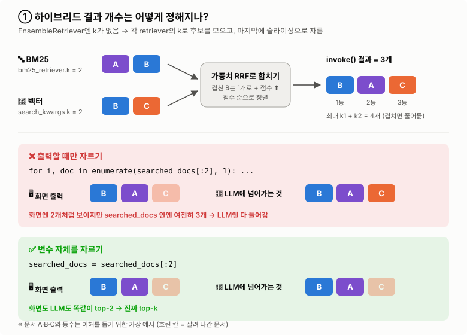
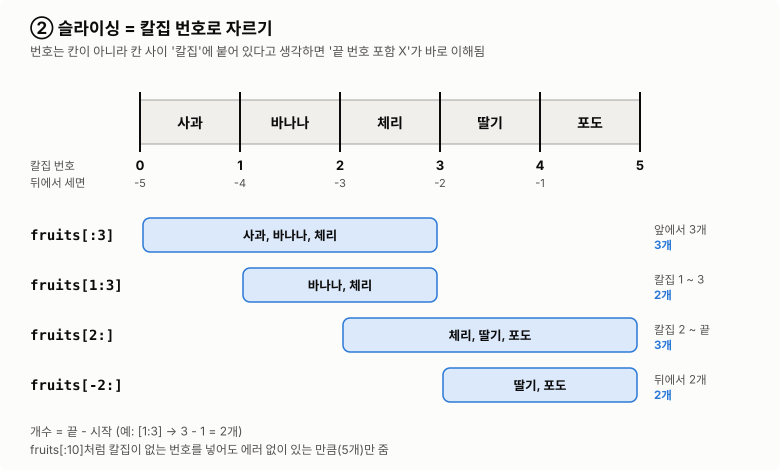

# 1117 노트

> 마인드맵 중 **1116 노트에 없던 내용**만 정리
> 이미 정리한 주제 → [1116_note.md](1116_note.md): 코사인 거리 · BM25 · RRF · 리랭킹 · Query 변환 · 정밀도/재현율/F1 · 충실도/답변 관련성 · 골든셋

---

## 1. 벡터 DB 종류

### 한 줄 요약

임베딩한 벡터를 **저장해 두고, 비슷한 벡터를 빠르게 찾아 주는** 저장소

| 벡터 DB        | 특징                                                | 언제 쓰나                   |
| -------------- | --------------------------------------------------- | --------------------------- |
| **InMemory**   | 메모리에만 저장 → 프로그램 끄면 **사라짐** (휘발성) | 잠깐 테스트                 |
| **Chroma**     | 내 컴퓨터에 파일로 저장, 설치 간단                  | 실습 · 작은 프로젝트        |
| **PGVector**   | **PostgreSQL**에 벡터 기능을 붙인 확장              | 이미 Postgres를 쓰는 서비스 |
| **Pinecone**   | 클라우드 서비스, 서버 관리 안 해도 됨 (유료)        | 운영 서비스                 |
| **OpenSearch** | 검색엔진 기반 → **BM25 + 벡터** 하이브리드에 강함   | 키워드 검색도 중요할 때     |

🗄️ 비유: 책을 어디에 꽂아 둘까?

- InMemory = 책상 위에 잠깐 쌓아 두기 (퇴근하면 치워짐)
- Chroma = 내 방 책장
- PGVector = 원래 쓰던 회사 서류함에 칸 하나 추가
- Pinecone = 돈 내고 쓰는 외부 창고

---

## 2. SQL Record Manager (중복 · 증분 관리)

### 한 줄 요약

벡터 DB에 **어떤 문서를 언제 넣었는지 장부(기록)**를 따로 SQL에 적어 두고, 문서가 바뀔 때 **바뀐 것만** 반영하는 도구

### 🤔 왜 필요해?

같은 PDF를 매번 통째로 다시 넣으면?

- 같은 청크가 **중복 저장** → 검색 결과에 같은 내용이 여러 번 나옴 😵
- 문서에서 지운 내용이 벡터 DB엔 **그대로 남음** → 옛날 정보로 답변 🚨
- 매번 전부 다시 임베딩 → **시간 · 비용 낭비** 💸

### 📒 비유: 도서관 대출 장부

사서가 장부에 "어떤 책이 · 어떤 버전으로 · 언제 들어왔는지" 적어 둔다.

- 새 책 → 장부에 추가하고 책장에 꽂기 ➕
- 똑같은 책이 또 옴 → 장부 보고 **"이미 있음"** 건너뛰기 ⏭️
- 개정판이 옴 → 옛날 판 빼고 새 판 꽂기 🔄
- 폐기된 책 → 책장에서도 빼기 🗑️

### 하는 일

| 상황                 | Record Manager가 하는 일                     |
| -------------------- | -------------------------------------------- |
| 처음 보는 청크       | 임베딩해서 벡터 DB에 **추가**                |
| 내용이 똑같은 청크   | **건너뜀** (중복 방지)                       |
| 내용이 바뀐 청크     | 옛것 **삭제** + 새것 **추가**                |
| 원본에서 사라진 청크 | 벡터 DB에서도 **삭제** (cleanup 설정에 따라) |

- 내용이 같은지는 청크 내용의 **해시(지문)**로 비교
- 이렇게 **바뀐 부분만** 반영하는 걸 **증분(incremental) 관리**라고 함

---

## 3. similarity_search_with_score (점수 보기)

### 한 줄 요약

검색 결과 문서와 함께 **얼마나 가까운지 점수**도 같이 돌려줌 → `(문서, 점수)` 쌍

### 📏 점수 해석 (수업 기준, 코사인 **거리**일 때)

| 거리 점수     | 의미                            |
| ------------- | ------------------------------- |
| **0 ~ 0.3**   | ✅ 적합 (질문과 아주 가까움)    |
| **0.3 ~ 0.7** | 🤔 보통                         |
| **0.7 ~**     | ❌ 부적합 (관련 없을 가능성 큼) |

⚠️ 주의할 점

1. **거리**는 **작을수록** 비슷하다 (유사도와 반대!)
   - 코사인 유사도 1 = 코사인 거리 0 = 완전 같은 방향 → [1116 노트 공식 참고](1116_note.md)
2. 위 기준은 **경험적인 기준**일 뿐 → 임베딩 모델 · 데이터마다 달라짐
3. 벡터 DB마다 점수 종류가 다름 (코사인 거리 / 유클리드 거리 / 유사도)
   - 코사인 거리: 0 ~ 2 (보통 0 ~ 1 근처) / 유클리드 거리: 0 ~ ∞
   - → 내가 쓰는 벡터 DB가 **어떤 점수를 주는지 먼저 확인**하기
   - 참고: `similarity_search_with_relevance_scores`는 **0 ~ 1, 클수록 비슷함**으로 맞춰서 돌려줌

💡 활용: 점수가 너무 나쁜 문서는 **LLM에 안 보내기** → 엉뚱한 문서 때문에 생기는 할루시네이션 줄이기

### 📏 거리 vs 관련도: 눈금자 두 개 (방향이 반대!)

**위: 코사인 거리** (`similarity_search_with_score`)

```
 0 ─────────────────────────────── 1
 ↑
 여기가 좋음! (가까이 있음 = 유사)
```

**아래: 관련도 점수** (`similarity_search_with_relevance_scores`)

```
 0 ───────────────────────── 0.8 ── 1
                                    ↑
                         여기가 좋음! (1에 가까울수록 유사)
```

**두 눈금자를 겹쳐 보면**

```
거리      0 ──── 0.2 ──────────────── 1
          🎯
관련도    1 ──── 0.8 ──────────────── 0
```

- 같은 문서를 **서로 반대편에서 잰 것**뿐
- **관련도 = 1 - 거리** (PGVector 코사인 기준, LangChain 내부 코드에서 확인)
- 관련도 0.8 = 거리 0.2 → 아주 가까운 문서 ✅

🎯 비유: 다트 게임

- 거리 = 과녁 정중앙에서 **얼마나 떨어졌나** (작을수록 좋음)
- 관련도 = 과녁 정중앙에 **얼마나 가깝나** (클수록 좋음)

### ✂️ score_threshold = 관련도 눈금자에 선 긋기

```python
SCORE_THRESHOLD = 0.7                    # "거리" 기준으로 생각한 값
searched_docs = vector_store.similarity_search_with_relevance_scores(
    query=query,
    score_threshold=1 - SCORE_THRESHOLD  # "관련도" 기준으로 뒤집음 → 0.3
)
```

- 이 메서드는 **관련도**로 말해야 알아들음 → 거리 0.7을 **관련도 0.3**으로 바꿔서 넘김
- 결과: **관련도 0.3 이상** = **거리 0.7 이하** 문서만 가져옴
- 선 **오른쪽**(1 쪽) 문서만 ✅ / 선 **왼쪽**(0 쪽) 문서는 버림 ❌

⚖️ 선을 어디에 긋느냐

- 선을 **높게** (예: 0.8) → 아주 비슷한 것만 → 정밀도 ⬆️ / 재현율 ⬇️ (하나도 안 나올 수도!)
- 선을 **낮게** (예: 0.3) → 웬만하면 다 가져옴 → 재현율 ⬆️ / 정밀도 ⬇️
- → [1116 노트: 정밀도 · 재현율 시소](1116_note.md)

### 📊 그래프로 보는 거리 vs 관련도



> 같은 문서를 **거리**(위)와 **관련도**(아래)로 잰 것 → 점 위치는 똑같고 **눈금 방향만 반대**
> 기준선(거리 0.7 = 관련도 0.3) 왼쪽 문서만 가져옴 ✅



> 거리가 0 → 1로 멀어지면, 관련도는 1 → 0으로 **똑같은 만큼** 내려감
> 필기의 **관련도 0.8 = 거리 0.2**도 이 직선 위의 한 점

---

## 4. Retriever 설정 (search_kwargs)

### 한 줄 요약

벡터 DB를 **검색기(retriever)**로 바꿀 때 "몇 개를, 어떤 조건으로 가져올지" 정하는 옵션

```python
retriever = vectorstore.as_retriever(
    search_type="similarity",
    search_kwargs={
        "k": 5,                                         # 상위 5개만 가져오기
        "filter": {"source": "academic_rules_2026.pdf"},  # 메타데이터 조건
    },
)
```

| 옵션          | 뜻                              | 비유                                       |
| ------------- | ------------------------------- | ------------------------------------------ |
| `k`           | **몇 개** 가져올지              | 검색 결과 **몇 페이지까지** 볼지           |
| `filter`      | **메타데이터 조건**에 맞는 것만 | 쇼핑몰 **카테고리 필터** ("2026년 학칙만") |
| `search_type` | 검색 방식                       | 아래 표                                    |

| search_type                    | 설명                                                        |
| ------------------------------ | ----------------------------------------------------------- |
| `"similarity"`                 | 그냥 가장 비슷한 순서 (기본값)                              |
| `"mmr"`                        | 비슷하면서도 **서로 겹치지 않게** 골고루 (중복 내용 줄이기) |
| `"similarity_score_threshold"` | 점수가 기준 이상인 것만 (`score_threshold`와 같이 씀)       |

💡 `k`와 정밀도/재현율 관계 → [1116 노트: 정밀도 · 재현율 시소](1116_note.md)

- k ⬆️ → 재현율 ⬆️ / 정밀도 ⬇️

---

## 5. Context Precision / Context Recall (RAG 버전 검색 지표)

### 한 줄 요약

1116 노트의 정밀도 · 재현율을 **RAG 평가(RAGAS)**에 맞게 바꾼 것
→ 검색해 온 **맥락(context)**이 얼마나 좋은지 채점

| 지표                  | 질문                                                        | 무엇 ↔ 무엇                   |
| --------------------- | ----------------------------------------------------------- | ----------------------------- |
| **Context Precision** | 가져온 맥락 중 **쓸모 있는 게 위쪽(상위)에** 있나?          | 검색한 맥락 ↔ 질문 · 모범정답 |
| **Context Recall**    | **모범정답을 만드는 데 필요한 정보**가 맥락에 다 들어 있나? | 모범정답 ↔ 검색한 맥락        |

🍕 예시: 모범정답 = "구토 · 설사 · 발작이 올 수 있고, 즉시 병원에 가야 함"

- 검색한 맥락에 "구토 · 설사 · 발작"은 있는데 "병원에 가라"는 없음
- → Context Recall ⬇️ (**정보 누락**)

### Context Recall이 낮으면?

**정보 누락** → 검색한 맥락에 답에 필요한 내용이 빠져 있음

- 원인 후보: 청크가 너무 잘게 잘림, k가 너무 작음, 질문이 애매함 ...
- 해결법 → [1116 노트: 재현율이 낮으면 청킹 크기를 키워야 해결?](1116_note.md)

### 🔗 골든셋과의 관계

- Context Recall은 **모범정답**이 있어야 계산 가능 → 골든셋 필요
- → [1116 노트: RAG 평가셋 (Golden Set)](1116_note.md)

---

## 6. LangChain 패키지별 역할

### 한 줄 요약

LangChain은 패키지 하나가 아니라 **역할별로 쪼개진 여러 패키지** → 필요한 것만 골라 설치

### 🧱 비유: 레고

| 패키지                       | 레고로 치면                          | 하는 일                                                                                                                                     |
| ---------------------------- | ------------------------------------ | ------------------------------------------------------------------------------------------------------------------------------------------- |
| **langchain-core**           | **기본 블록 규격**                   | 모든 패키지가 같이 쓰는 기본 부품 · 규칙: 프롬프트, 메시지, **output parser**, `Runnable`(파이프 `\|` 연결), Document, Retriever 인터페이스 |
| **langchain**                | **최신 완성 키트**                   | v1부터 **에이전트 중심**: `create_agent`, 미들웨어, `init_chat_model` 등                                                                    |
| **langchain-classic**        | **단종된 옛날 키트**                 | v1 이전 기능 모음: 옛날 Chain(`RetrievalQA` 등), 옛날 retriever, indexing(Record Manager) 등 → 옛날 예제 코드가 사용                        |
| **langchain-community**      | **사용자 제작 부품**                 | 커뮤니티 연동 모음: 문서 로더(`PyMuPDFLoader`, 웹 로더), 여러 벡터DB · 도구 연동                                                            |
| **langchain-openai**         | **공식 브랜드 부품** (파트너 패키지) | OpenAI 연동: `ChatOpenAI`, `OpenAIEmbeddings`                                                                                               |
| **langchain-postgres**       | 〃                                   | PostgreSQL 연동: `PGVector` (Docker로 띄운 DB와 연결)                                                                                       |
| **langchain-text-splitters** | **가위** ✂️                          | 문서 자르기(청킹): `RecursiveCharacterTextSplitter` 등                                                                                      |

> 파트너 패키지 = `langchain-openai`, `langchain-anthropic`, `langchain-chroma`처럼 **회사 · 서비스 이름**이 붙은 것

### 🐍 설치 이름 vs import 이름

설치는 **하이픈(`-`)**, import는 **언더바(`_`)**

| `uv add` 할 때             | `import` 할 때             |
| -------------------------- | -------------------------- |
| `langchain-core`           | `langchain_core`           |
| `langchain-openai`         | `langchain_openai`         |
| `langchain-text-splitters` | `langchain_text_splitters` |

### 🔍 RAG에서 어디에 쓰이나

```
PDF 불러오기     → langchain-community      (PyMuPDFLoader)
청크로 자르기    → langchain-text-splitters (RecursiveCharacterTextSplitter)
임베딩 · LLM     → langchain-openai         (OpenAIEmbeddings, ChatOpenAI)
벡터DB 저장      → langchain-postgres       (PGVector)
프롬프트 · 출력  → langchain-core           (ChatPromptTemplate, output parser)
전체 연결 (|)    → langchain-core           (Runnable 파이프)
```

### 💡 "이 클래스 어느 패키지에 있지?" 찾는 법

1. LangChain 공식 문서(API Reference)에서 클래스 이름 검색
2. 노트북에서 직접 확인
   ```python
   import langchain_core.output_parsers as m
   print(dir(m))   # 모듈 안에 뭐가 있는지 목록 출력
   ```

⚠️ LangChain은 버전이 바뀌면서 위치가 자주 바뀜 (특히 v1에서 많이 이동)
→ 옛날 블로그 코드 import가 안 되면 대부분 **`langchain-classic`이나 `langchain-core`로 옮겨진 경우**

### 🐛 실제로 겪은 에러

| 에러 난 코드                               | 원인                                                                                 |
| ------------------------------------------ | ------------------------------------------------------------------------------------ |
| `uv add langhchain-postgres`               | 오타 (`langhchain` → `langchain`) → package not found                                |
| `from langchain_output_parsers import ...` | 그런 패키지 없음 → output parser는 **core 패키지의 `output_parsers` 모듈** 안에 있음 |
| `from langchian_community.retrievers import ...` | 오타 (`langchian` → `langchain`) → `ModuleNotFoundError` → **설치 전에 철자부터 확인!** |
| `EnsembleRetriever(weighs=[...])` | 오타 (`weighs` → `weights`) → **에러 없이 조용히 무시됨** 🪤 (9-4 참고) |

---

## 7. 프롬프트 엔지니어링 · 컨텍스트 엔지니어링 · 파인튜닝

### 🧑‍🍳 한눈에 비교: 신입 알바 키우기

| 방법                               | 알바로 치면                              | 모델이 바뀌나?      |
| ---------------------------------- | ---------------------------------------- | ------------------- |
| **프롬프트 엔지니어링**            | 일 시작할 때 **지시를 잘 해 주기** 🗣️    | ❌                  |
| **컨텍스트 엔지니어링** (RAG 포함) | **책상 위에 필요한 서류만** 올려 두기 📚 | ❌                  |
| **파인튜닝**                       | **학원 보내서 재교육** → 몸에 익히기 🎓  | ✅ 모델 자체가 바뀜 |

---

### 7-1. 프롬프트 엔지니어링 (Prompt Engineering)

**LLM이 원하는 답을 내도록 지시문(프롬프트)을 잘 짜는 기술**

- ❌ "손님 오면 알아서 잘 해" → 제멋대로 함
- ✅ "너는 카페 직원이야. 메뉴판에 있는 것만 추천해. 모르면 매니저한테 물어보라고 해."
- → **같은 모델이라도 지시에 따라 답의 품질이 확 달라짐**

#### 🧰 자주 쓰는 기법

| 기법                       | 뜻                   | 예시                                           |
| -------------------------- | -------------------- | ---------------------------------------------- |
| **역할 부여** (Role)       | "너는 ~야"           | "너는 대학교 학사 규정 안내 도우미야."         |
| **명확한 지시**            | 할 일을 구체적으로   | "3문장 이내로, 존댓말로 답해."                 |
| **출력 형식 지정**         | 답의 모양을 정함     | "JSON으로: {\"answer\": ..., \"source\": ...}" |
| **Few-shot**               | 예시를 몇 개 보여 줌 | Q/A 예시 2~3개 → 같은 스타일로 답함            |
| **Chain-of-Thought** (CoT) | 단계별로 생각하게 함 | "단계별로 차근차근 생각한 뒤 답해."            |
| **제약 조건**              | 하면 안 되는 것      | "추측하지 마. 개인정보는 말하지 마."           |

#### 🔍 RAG 프롬프트 기본 모양

```
너는 학사 규정 안내 도우미야.
아래 [문서]에 있는 내용만 근거로 답해.
[문서]에 없는 내용이면 "문서에서 찾을 수 없습니다"라고 답해.

[문서]
{context}      ← 검색해 온 청크가 들어가는 자리

[질문]
{question}     ← 사용자 질문이 들어가는 자리
```

- **"문서에 있는 내용만 근거로"** → 충실도 ⬆️, 할루시네이션 ⬇️ → [1116 노트: 생성 지표](1116_note.md)
- **"모르면 모른다고"** → 검색 실패 시 지어내지 않게 막기
- `{context}`, `{question}` 빈칸 채우기 = LangChain **`ChatPromptTemplate`**

⚠️ 한계: 검색해 온 문서가 엉망이면 프롬프트를 잘 짜도 답이 엉망 → **검색이 먼저!**

---

### 7-2. 컨텍스트 엔지니어링 (Context Engineering)

**LLM에게 무엇을, 얼마나, 어떤 순서로 보여 줄지 설계하는 기술**
→ 지시문 한 줄이 아니라 **LLM이 보는 전체 정보**를 다룸 (프롬프트 엔지니어링은 이것의 **일부**)

#### 📦 컨텍스트에 들어가는 것들

```
┌─────────────────────────────┐
│ 시스템 프롬프트 (역할, 규칙)    │ ← 프롬프트 엔지니어링
│ 검색해 온 문서 (RAG)           │ ← 우리가 배운 것!
│ 이전 대화 기록 (메모리)         │
│ 도구 실행 결과 (API, DB 조회)   │
│ 사용자 질문                    │
└─────────────────────────────┘
```

#### 🤔 컨텍스트는 "많을수록 좋은" 게 아니다

1. **공간 한정**: 컨텍스트 윈도우(토큰 수)에 한계 + 많이 넣을수록 **비용 · 속도** 나빠짐
2. **잡음**: 관련 없는 문서가 섞이면 답이 흐려짐 → 1116 노트의 **정밀도** 얘기
3. **Lost in the Middle**: 긴 컨텍스트의 **중간 정보를 놓치는** 경향 → 중요한 건 **앞이나 뒤**에

#### 🧰 주요 기법

| 기법                     | 뜻                      | 배운 것과 연결                           |
| ------------------------ | ----------------------- | ---------------------------------------- |
| **고르기** (Select)      | 필요한 정보만 골라 넣기 | RAG 검색, 리랭킹, `k`, `score_threshold` |
| **줄이기** (Compress)    | 길면 요약해서 넣기      | 긴 대화 기록 요약                        |
| **정리하기** (Structure) | 구역을 나눠 보기 좋게   | `[문서]`, `[질문]` 구분, 출처 표시       |
| **순서 정하기** (Order)  | 중요한 걸 앞에          | 리랭킹 후 **1등 문서를 맨 앞**에         |
| **나눠 담기** (Isolate)  | 일을 쪼개서 따로 처리   | 에이전트마다 필요한 컨텍스트만 따로      |

#### 💡 RAG = 컨텍스트 엔지니어링

```
Query 변환 → 검색 → RRF → 리랭킹 → score_threshold → 상위 k개만 → 프롬프트에 넣기
└──────────────────── 전부 컨텍스트 엔지니어링 ────────────────────┘
```

---

### 7-3. 파인튜닝 (Fine-tuning)

**이미 똑똑한 LLM을 내 데이터로 추가 학습시켜서 모델 자체를 바꾸는 것**

#### 🎓 어떻게 해?

"이런 질문엔 이렇게 답해" **예시 쌍을 수백~수천 개** 만들어서 학습

```
{"질문": "환불 돼요?", "답변": "고객님, 구매 후 7일 이내라면 환불 가능합니다 😊"}
{"질문": "배송 언제 와요?", "답변": "고객님, 보통 2~3일 소요됩니다 😊"}
... × 1000개
```

→ 프롬프트에 말 안 해도 **"고객님 ... 😊" 말투가 몸에 뱀**

💡 **LoRA**: 모델 전체가 아니라 **일부만 살짝** 학습 → 훨씬 싸고 빠름 (요즘 많이 씀)

#### ⚖️ RAG vs 파인튜닝

|                | RAG 📖                          | 파인튜닝 🎓                   |
| -------------- | ------------------------------- | ----------------------------- |
| 잘하는 것      | **지식** 넣기 (학칙, 사내 문서) | **말투 · 형식 · 행동** 바꾸기 |
| 정보가 바뀌면  | 문서만 교체하면 끝 ✅           | **다시 학습** 😵              |
| 출처 보여 주기 | 가능 ("학칙 32조 참고") ✅      | 어려움                        |
| 할루시네이션   | 문서 근거로 줄일 수 있음        | 외운 걸 틀리게 기억할 수 있음 |
| 비용 · 난이도  | 비교적 쉬움                     | 데이터 준비 + 학습 비용 ⬆️    |

🎯 예시

- **"2026년 학칙이 뭐야?"** → 매년 바뀌는 **지식** → **RAG** (매뉴얼만 갈아 끼우기)
- **"항상 우리 회사 말투로, JSON 형식으로 답해"** → 몸에 배야 하는 **습관** → **파인튜닝**

---

### 🪜 보통 이 순서로 시도

```
① 프롬프트 엔지니어링  → 제일 싸고 빠름. 대부분 여기서 해결
② RAG                → 모델이 모르는 지식이 필요할 때
③ 파인튜닝            → 그래도 안 되는 말투 · 형식 · 전문 작업
```

👉 쉬운 것부터, 안 되면 다음 단계로 / **RAG + 파인튜닝을 같이** 쓰기도 함

### ✅ 한 줄 요약

- 프롬프트 엔지니어링 = **어떻게 말할까** 🗣️
- 컨텍스트 엔지니어링 = **무엇을 보여 줄까** 📚 (프롬프트 포함)
- 파인튜닝 = **모델을 재교육** 🎓 (자주 바뀌는 지식은 RAG, 몸에 배야 하는 습관은 파인튜닝)

---

## 8. 벡터 검색 = semantic 기준

벡터 검색은 **글자가 같은지**가 아니라 **뜻이 비슷한지**로 찾는다

### BM25 vs 벡터 검색

|      | BM25 (키워드 검색)                  | 벡터 검색                                   |
| ---- | ----------------------------------- | ------------------------------------------- |
| 기준 | **렉시컬 (Lexical)** = 글자 기준 🔤 | **시맨틱 (Semantic)** = 의미 기준 🧠        |
| 질문 | "같은 **단어**가 들어 있나?"        | "같은 **뜻**인가?"                          |
| 방법 | 단어 등장 횟수 세기 (TF-IDF)        | 문장을 벡터로 바꿔서 **방향** 비교 (코사인) |

### 🍕 예시: "반려견이 초콜릿을 먹었어요"

| 문서                              | BM25 🔤                     | 벡터 🧠                      |
| --------------------------------- | --------------------------- | ---------------------------- |
| "**강아지** 초콜릿 중독 증상"     | 🤔 "반려견"이란 글자가 없음 | ✅ 반려견 ≈ 강아지, 같은 뜻! |
| "**개**가 **카카오** 먹으면 위험" | ❌ 겹치는 단어가 거의 없음  | ✅ 뜻이 비슷함               |

👉 **다른 단어로 말해도** 뜻이 같으면 찾음 = 시맨틱 검색의 힘 💪

### 🤔 벡터가 항상 이길까? → 아니!

| 질문                      | 벡터가 약한 이유                                                             |
| ------------------------- | ---------------------------------------------------------------------------- |
| "**학칙 제32조** 알려 줘" | "제32조"와 "제33조"는 **뜻이 거의 비슷한 벡터** → 엉뚱한 조항이 나올 수 있음 |
| "**ERR-4012** 에러 뭐야?" | 코드 · 고유명사는 의미보다 **글자 그대로** 맞아야 함                         |

→ 이럴 땐 **BM25가 정확** 🔤

### ✅ 그래서 하이브리드 검색

```
벡터 (의미) 🧠  +  BM25 (글자) 🔤  →  RRF로 합치기  =  하이브리드 검색
```

- 서로 약점을 메워 줌 → "뜻도 맞고 글자도 맞는" 문서를 잘 찾음
- 관련 내용 → [1116 노트: BM25 vs 코사인 비교 · RRF](1116_note.md)

---

## 9. BM25 · 벡터 · 하이브리드 검색 실사용 코드

### 9-0. BM25의 TF · IDF 다시 보기

BM25 점수 = 질문의 단어마다 **"이 문서에서 얼마나 중요한가"**를 계산해서 **더한 것**

```
BM25 점수 = Σ (질문의 각 단어)  IDF  ×  TF 부분(포화 + 길이 보정)
                              ↑            ↑
                     얼마나 귀한 단어?   이 문서에 얼마나 나오나?
```

|         | TF (Term Frequency)                           | IDF (Inverse Document Frequency)                      |
| ------- | --------------------------------------------- | ----------------------------------------------------- |
| 뜻      | **이 문서 안에서** 단어가 몇 번 나오나        | **전체 문서 중** 몇 개 문서에 나오나의 **역수**       |
| 규칙    | 많이 나올수록 점수 ⬆️                         | **드문** 단어일수록 점수 ⬆️ / 어디에나 있는 단어는 ⬇️ |
| 예시    | "휴학"이 3번 나오는 문서 > 1번 나오는 문서    | "휴학"(몇 문서에만) > "학칙"(거의 모든 문서에)        |
| 🍜 비유 | 라면집 메뉴판에 "라면"이 10번 → 라면집이구나! | "물"은 모든 식당에 있음 → 식당 구분에 쓸모없음        |

BM25가 TF-IDF보다 똑똑한 점 2가지

1. **TF 포화** (`k1`): 단어가 100번 나와도 10번보다 10배 점수 X → 어느 순간 거의 안 오름
2. **길이 보정** (`b`): 긴 문서는 단어가 많이 나올 수밖에 없으니 감안해서 깎음

📊 그래프 → [1116 노트: 그래프로 보는 BM25](1116_note.md)

---

### 9-1. 공통 준비: 문서

```python
from langchain_core.documents import Document

docs = [
    Document(page_content="학칙 제32조: 휴학은 최대 2년까지 가능하다", metadata={"id": 1}),
    Document(page_content="학칙 제33조: 복학은 학기 시작 전에 신청한다", metadata={"id": 2}),
    Document(page_content="강아지가 초콜릿을 먹으면 구토와 발작이 올 수 있다", metadata={"id": 3}),
    Document(page_content="장학금은 직전 학기 평점 3.5 이상이어야 받을 수 있다", metadata={"id": 4}),
]
```

---

### 9-2. BM25 검색 (키워드 🔤)

📦 설치

```bash
uv add rank-bm25 kiwipiepy
```

- `rank-bm25`: BM25 계산 라이브러리 (`BM25Retriever`가 내부에서 사용)
- `kiwipiepy`: **한국어 형태소 분석기** (아래 ⚠️ 참고)

```python
from langchain_community.retrievers import BM25Retriever
from kiwipiepy import Kiwi

kiwi = Kiwi()

def kiwi_tokenize(text):
    # 명사(NN), 숫자(SN), 동사(VV), 형용사(VA), 어근(XR), 영어(SL)만 남기기
    return [t.form for t in kiwi.tokenize(text)
            if t.tag.startswith(("NN", "SN", "VV", "VA", "XR", "SL"))]

bm25_retriever = BM25Retriever.from_documents(
    docs,
    k=2,                              # 상위 2개
    preprocess_func=kiwi_tokenize,    # 👈 한국어는 꼭 바꿔 주기!
)

bm25_retriever.invoke("휴학 제32조")   # → 1번(제32조) 1등 ✅
```

#### ⚠️ 한국어 함정: 기본 토큰화는 "띄어쓰기"로만 자른다

직접 돌려 본 결과

| 토큰화          | "학칙 제32조: 휴학은 최대 2년까지 가능하다"                | "휴학 제32조" 검색 결과   |
| --------------- | ---------------------------------------------------------- | ------------------------- |
| 기본 (띄어쓰기) | `학칙`, `제32조:`, `휴학은`, `최대`, `2년까지`, `가능하다` | ❌ 엉뚱한 문서 (4번, 3번) |
| kiwi (형태소)   | `학칙`, `32`, `휴학`, `최대`, `2`, `년`, `가능`            | ✅ 1번(32조) → 2번        |

- 기본 방식은 `휴학은` ≠ `휴학`, `제32조:` ≠ `제32조` → **조사 · 문장부호 때문에 단어가 안 맞음**
- 영어는 띄어쓰기 = 단어라서 괜찮지만, 한국어는 **조사가 붙어서** 형태소 분석이 필요
- 💡 점수가 전부 0이어도 `BM25Retriever`는 **k개를 무조건 돌려줌** → 엉뚱한 문서가 나와도 모를 수 있음!

#### 🔢 `k` = 몇 개 돌려줄지 (top-k)

```python
bm25_retriever = BM25Retriever.from_documents(raw_documents)
bm25_retriever.k = 2          # 점수 높은 순으로 2개만 (만든 뒤에 변경)

# 아래와 결과 같음
BM25Retriever.from_documents(raw_documents, k=2)   # 만들 때 바로 지정
```

- `from_documents`의 **기본값은 k = 4** (직접 확인)
- 🔍 비유: 검색 결과를 **몇 개까지 볼지** 정하기
- k 작게 → 정밀도 ⬆️ (대신 놓칠 수 있음) / k 크게 → 재현율 ⬆️ (대신 엉뚱한 것도 섞임)

⚠️ **점수가 0이어도 k개를 무조건 채워서** 돌려줌 → chapter05 사내 IT 규정 예시로 직접 돌려 본 결과 (기본 토큰화, k=2)

| 질문 | 문서별 점수 (보안 / 원격근무 / 장비 / 계정) | 결과 |
| --- | --- | --- |
| `VPN` | 0 / **0** / 0 / 0 | ❌ 계정 관리, 장비 지급 (**VPN 문서조차 안 나옴!**) |
| `VPN을` | 0 / **0.83** / 0 / 0 | 원격 근무 ✅ + 계정 관리 (점수 0인데 끼어듦) |
| `재택 근무` | 0 / **2.03** / 0 / 0 | 원격 근무 ✅ + 계정 관리 (점수 0인데 끼어듦) |

- 문서엔 `VPN을`으로 붙어 있음 → 띄어쓰기 토큰화로는 `VPN` ≠ `VPN을` → **한국어 함정** (위 kiwi 해결법 참고)
- 점수 0인 문서도 k개를 채우려고 들어옴 → LLM에 **쓸모없는 문서**가 같이 감 (정밀도 ⬇️)

💡 직접 확인하는 법

```python
print(bm25_retriever.vectorizer.get_scores(["VPN"]))   # 문서별 BM25 점수
```

#### 🤔 띄어쓰기 · 조사 때문에 안 되면 BM25는 치명적인 거 아냐?

**기본 설정 그대로 한국어에 쓰면 → 치명적 🚨 / 하지만 해결법이 있음 ✅**

- 문제는 BM25 **공식**이 아니라, 그 앞 단계인 **토큰화(문장을 단어로 자르기)**
- 🍳 비유: BM25 = **레시피**, 토큰화 = **재료 손질** → 감자를 껍질째 통으로 넣으면 망함. 레시피 잘못이 아니라 **손질**을 바꿔야 함
- 문제 두 가지
  1. **조사**: 띄어쓰기를 완벽하게 해도 `VPN을` ≠ `VPN`
  2. **띄어쓰기 실수**: 문서 `재택 근무` vs 질문 `재택근무`

#### 🧪 토크나이저 3가지 직접 비교 (chapter05 사내 IT 규정 예시)

| 토크나이저 | `VPN` (조사) | `재택 근무` | `재택근무` (붙여 씀) | `비밀 번호` (띄어 씀) |
| --- | --- | --- | --- | --- |
| 기본 (띄어쓰기) | ❌ | ✅ | ❌ | ❌ |
| kiwi (형태소) | ✅ | ✅ | ❌ | ✅ |
| **2-gram** (글자 2개씩) | ✅ | ✅ | ✅ | ✅ |

📊 그래프로 보기



> 기본 1/4 → kiwi 3/4 → **2-gram 4/4**
> ⚠️ 점수는 같은 토크나이저 안에서만 비교 가능 (행끼리 크기 비교 X)



> 같은 조각(파란색)이 있어야 점수가 생김 → 2-gram만 `재택근무` / `재택 근무`가 똑같이 잘림

**왜 이런 결과가?**

```
kiwi    "재택근무"  → ['재택근무']         ← 한 단어로 봄
        "재택 근무" → ['재택', '근무']     ← 두 단어로 봄  → 안 맞음 ❌

2-gram  "재택근무"  → ['재택', '택근', '근무']
        "재택 근무" → ['재택', '택근', '근무']  ← 띄어쓰기 지우고 자르니 똑같음 ✅
```

```python
def bigram_tokenize(text):
    text = "".join(ch for ch in text if ch.isalnum())   # 띄어쓰기 · 문장부호 제거
    return [text[i:i+2] for i in range(len(text) - 1)]  # 글자 2개씩 자르기

BM25Retriever.from_documents(docs, preprocess_func=bigram_tokenize)
```

#### ⚖️ 그럼 2-gram이 무조건 최고?

| | kiwi (형태소) | 2-gram |
| --- | --- | --- |
| 조사 문제 | ✅ | ✅ |
| 띄어쓰기 실수 | 🤔 경우에 따라 실패 | ✅ 강함 |
| 단점 | 붙여 쓴 복합어를 한 단어로 볼 수 있음 | 조각이 많아짐 → **엉뚱한 매칭** 가능 (예: "택근" 같은 의미 없는 조각), 인덱스 커짐 |

→ 정답은 하나가 아님 → **내 데이터 + 골든셋으로 측정**해서 고르기

#### 🛠️ 해결법 정리

1. **형태소 분석기** (kiwi, mecab 등) → 조사 분리
2. **n-gram** → 띄어쓰기 실수에 강함
3. **하이브리드 검색** → BM25가 놓쳐도 **벡터가 뜻으로** 찾아 줌 🤝

💡 실제 검색엔진(Elasticsearch)도 한국어는 **형태소 분석기(nori)**를 따로 붙여서 BM25를 씀
👉 한국어에서는 **"BM25 단독"보다 "BM25 + 벡터"**가 더 중요한 이유

#### BM25의 한계 (직접 확인)

- "반려견"으로 검색 → 모든 문서 점수 **0** (문서엔 "강아지"만 있음)
- → **동의어를 못 찾음** → 그래서 벡터 검색이 필요

---

### 9-3. 벡터 검색 (의미 🧠) — PGVector

```python
import os
from dotenv import load_dotenv
from langchain_openai import OpenAIEmbeddings
from langchain_postgres import PGVector

load_dotenv()

vector_store = PGVector(
    embeddings=OpenAIEmbeddings(model="text-embedding-3-small"),
    collection_name="hybrid_demo",              # 테이블 안의 "폴더 이름" 같은 것
    connection=os.getenv("DATABASE_URL"),       # postgresql+psycopg://.../rag_db
)
vector_store.add_documents(docs)                # 임베딩 → DB 저장 (OpenAI API 호출 = 비용 발생)

vector_retriever = vector_store.as_retriever(search_kwargs={"k": 2})
vector_retriever.invoke("반려견이 초콜릿 먹었어요")   # → "강아지" 문서를 뜻으로 찾음
```

- `add_documents`를 **여러 번 실행하면 중복 저장**됨 → 2번 섹션의 Record Manager가 필요한 이유
- 벡터 검색의 약점: "제32조" vs "제33조"처럼 **뜻이 비슷한 숫자 · 코드**를 헷갈릴 수 있음

---

### 9-4. 하이브리드 검색 (🔤 + 🧠) — EnsembleRetriever

```python
from langchain_classic.retrievers import EnsembleRetriever

hybrid_retriever = EnsembleRetriever(
    retrievers=[bm25_retriever, vector_retriever],
    weights=[0.5, 0.5],      # BM25 : 벡터 비율
)

hybrid_retriever.invoke("휴학 제32조")
```

내부 계산 (LangChain 코드에서 직접 확인)

```
점수 += weight / (등수 + c)      ← c 기본값 = 60
```

→ 1116 노트의 **RRF** 공식 `1 / (등수 + 60)`에 **가중치를 곱한 것** (Weighted RRF)

#### ✍️ 필기: 왜 점수를 그냥 가중합하면 안 되고, 등수(RRF)를 쓰나?

**① 점수 범위가 다르다**

| | 점수 범위 | 예시 |
| --- | --- | --- |
| BM25 점수 | 0 ~ ∞ | 20, 21, 31 ... |
| 벡터 점수 | 0 ~ 1 | 0.7, 0.8 ... |

**② 그냥 가중합하면?** (BM25 0.2 · 벡터 0.8로 벡터를 더 믿겠다고 정해도)

```
0.2 × 21  +  0.8 × 0.7  =  4.2 + 0.56  =  4.76
└ BM25 ┘     └ 벡터 ┘
```

→ 벡터에 가중치를 4배 줬는데도 **BM25가 점수의 거의 전부**를 차지 😵 → 가중치가 의미 없어짐

**③ 그래서 점수 대신 등수를 쓴다 (Weighted RRF)**

```
RRF 점수 = 가중치 × 1 / (등수 + k)      ← k = 60
```

가중치: BM25 **0.2**, 벡터 **0.8**

| 문서 | BM25 등수 | 벡터 등수 | 계산 | RRF 점수 |
| --- | --- | --- | --- | --- |
| A | 1등 | 3등 | 0.2 × 1/61 + 0.8 × 1/63 = 0.00328 + 0.01270 | 0.01598 |
| **B** | 2등 | **1등** | 0.2 × 1/62 + 0.8 × 1/61 = 0.00323 + 0.01311 | **0.01634** 🏆 |

→ 등수는 둘 다 **1, 2, 3...** 같은 단위라서 가중치가 **제대로 먹힘**
→ 벡터를 더 믿기로 했으니(0.8) **벡터 1등인 B**가 최종 1등

#### 🎚️ 가중치가 순위를 뒤집는 예

| 문서 | BM25 | 벡터 | 가중치 0.5 : 0.5 | BM25 0.8 : 벡터 0.2 | BM25 0.2 : 벡터 0.8 |
| --- | --- | --- | --- | --- | --- |
| X | 1등 | 2등 | 동점 🤝 | **X 승** 🏆 | Y 승 |
| Y | 2등 | 1등 | 동점 🤝 | X 승 | **Y 승** 🏆 |

→ 가중치 = **"어느 심사위원 말을 더 믿을지"** (슈스케 비유: 문자투표 vs 심사위원 비중)
→ `EnsembleRetriever(weights=[0.2, 0.8])`가 바로 이 계산

#### ⚖️ weights 정하는 법

| 사용자 질문 스타일                      | 추천                       |
| --------------------------------------- | -------------------------- |
| 조항 번호 · 에러 코드 · 고유명사가 많음 | BM25 ⬆️ (예: `[0.7, 0.3]`) |
| 자연스러운 말 · 다른 표현이 많음        | 벡터 ⬆️ (예: `[0.3, 0.7]`) |

→ 감으로 정하지 말고 **골든셋으로 채점**하며 조절 ([1116 노트: 개선 · 회귀 검증](1116_note.md))

---

#### 🧩 하이브리드 검색 = EnsembleRetriever?

반은 맞음 → EnsembleRetriever는 하이브리드를 **만드는 방법 중 하나**

| | 뜻 |
| --- | --- |
| **하이브리드 검색** | **개념**: BM25(글자) + 벡터(뜻)를 같이 쓰자 💡 |
| **EnsembleRetriever** | **도구**: LangChain에서 여러 retriever를 **가중치 RRF로 합쳐 주는** 클래스 🔧 |

- 🍳 비유: 볶음밥(하이브리드) = 요리 이름 / 프라이팬(EnsembleRetriever) = 도구 중 하나
- retriever라면 **아무거나** 합칠 수 있음 (벡터 + 벡터도 가능) → "BM25 + 벡터" 조합일 때 하이브리드
- 다른 방법: 검색 DB가 **직접 하이브리드를 지원**하는 경우도 있음 (Elasticsearch, OpenSearch 등 → 쓰기 전 공식 문서 확인)
- ⚠️ 실습 방식의 한계: `BM25Retriever`는 문서를 **전부 파이썬 메모리에** 올려서 계산 → 문서가 많아지면 부담, 문서가 바뀌면 다시 만들어야 함

#### 🔢 하이브리드 결과에서 top-k 정하기

**EnsembleRetriever에는 `k` 옵션이 없음!** (직접 확인: `retrievers`, `weights`, `c`, `id_key`만 있음)

최종 개수는 이렇게 정해짐

```
BM25   → bm25_retriever.k 개     ┐
                                  ├→ 합치기 (겹치면 1개로) → 최대 (k1 + k2)개
벡터   → search_kwargs의 k 개     ┘
```

→ chapter05 실습은 2 + 2 → **최대 4개**

**top-k 정하는 두 가지 방향**

1. **재료 줄이기**: 각 retriever의 `k` 조절 → 후보 개수 (최종 개수를 딱 맞추진 못함)
2. **결과 자르기**: `invoke()` 결과는 **RRF 점수 순으로 정렬된 리스트** → 슬라이싱 ✂️

```python
searched_docs = hybrid_retriever.invoke(query)
searched_docs = searched_docs[:2]       # ✅ 변수 자체를 잘라야 진짜 top-2

for i, doc in enumerate(searched_docs, 1):
    print(f"Rank: {i}, doc={doc.page_content}")
```

⚠️ 출력할 때만 자르면?

```python
for i, doc in enumerate(searched_docs[:2], 1):   # 화면엔 2개
    ...
# 하지만 searched_docs 안에는 여전히 4개 → LLM에 넘기면 4개가 다 들어감!
```

💡 실무 패턴: ① 각 retriever `k`는 **넉넉하게** (재현율 ⬆️) → ② 슬라이싱으로 **최종 개수** 맞추기 (정밀도 ⬆️)



#### ✂️ 파이썬 슬라이싱 (리스트 자르기)

```python
fruits = ["사과", "바나나", "체리", "딸기", "포도"]
#   위치:   0       1        2       3       4

fruits[:3]    # ['사과', '바나나', '체리']   ← 앞에서 3개
fruits[1:3]   # ['바나나', '체리']           ← 1번부터 3번 "직전"까지
fruits[2:]    # ['체리', '딸기', '포도']     ← 2번부터 끝까지
fruits[-2:]   # ['딸기', '포도']             ← 뒤에서 2개
fruits[:10]   # 5개 전부                     ← 모자라도 에러 없음!
```

- 규칙: `리스트[시작:끝]` → **끝 번호는 포함 X** (직전까지)
- 시작 비우면 처음부터, 끝 비우면 마지막까지
- 🍕 비유: 피자 칼 → `[:3]` = 처음부터 3번째 칼집까지 잘라서 **3조각**



#### 🪤 실습하다 겪은 함정 2가지

**① 없는 옵션을 넣어도 에러가 안 남**

EnsembleRetriever는 모르는 인자를 **조용히 무시** (`extra = "ignore"`, 직접 확인)

| 코드 | 결과 |
| --- | --- |
| `EnsembleRetriever(..., k=2)` | 에러 없음 → **아무 효과 없음** 😱 |
| `EnsembleRetriever(..., weighs=[0.2, 0.8])` | 오타인데 에러 없음 → 가중치 **무시**되고 기본값(반반)으로 동작 |

- `weighs=[0.5, 0.5]`는 기본값도 마침 반반이라 **결과가 같아서 티가 안 남** → 나중에 비율 바꿀 때 한참 헤맴
- ✅ 확인법: 가중치를 `[1.0, 0.0]` ↔ `[0.0, 1.0]`으로 바꿔서 결과가 달라지는지 보기

**② 자동완성이 엉뚱한 import를 몰래 추가**

```python
from re import search    # ← 직접 안 썼는데 생김
```

- 원인: VS Code 설정 `"python.analysis.autoImportCompletions": true`
- `searched_docs` 타이핑 중 자동완성에서 `search`가 선택되면 → **import 줄이 맨 위에 자동 추가**
- 💡 자동완성 쓴 뒤엔 **맨 위 import 줄이 늘었는지** 확인하는 습관!

### 🔍 세 가지 한눈에 비교

|                            | BM25 🔤                             | 벡터 🧠                                   | 하이브리드 🤝       |
| -------------------------- | ----------------------------------- | ----------------------------------------- | ------------------- |
| LangChain 클래스           | `BM25Retriever`                     | `vector_store.as_retriever()`             | `EnsembleRetriever` |
| 패키지                     | `langchain_community` + `rank-bm25` | `langchain_postgres` + `langchain_openai` | `langchain_classic` |
| "휴학 제32조"              | ✅ (한국어 토큰화 필요)             | 🤔 33조와 헷갈릴 수 있음                  | ✅                  |
| "반려견이 초콜릿 먹었어요" | ❌ 점수 0                           | ✅                                        | ✅                  |
| 비용                       | 무료 · 빠름                         | 임베딩 API 비용                           | 둘 다               |

### 📝 핵심 포인트

1. **한국어 BM25는 형태소 분석기 필수** → `preprocess_func`에 kiwi 같은 토크나이저 넣기
2. BM25는 **글자**, 벡터는 **뜻** → 서로 못 찾는 걸 찾아 줌
3. `EnsembleRetriever` = **가중치 RRF** (`weight / (등수 + 60)`)
4. weights는 **골든셋으로 측정**해서 정하기

### ✅ 실행 확인 내역 (2026-11-17)

- ✔️ BM25 (기본 vs kiwi 토큰화), `EnsembleRetriever` → **임시 환경**에서 직접 실행해서 결과 확인
- ✔️ `EnsembleRetriever`의 `c = 60`, 계산식 → LangChain 소스 코드로 확인
- ⚠️ PGVector 부분 → 클래스 인자 이름만 확인, **실제 DB · OpenAI API로는 실행 안 해 봄**
- ⚠️ `rank-bm25`, `kiwipiepy`는 **프로젝트에 설치 안 됨** → 쓰려면 `uv add rank-bm25 kiwipiepy`
